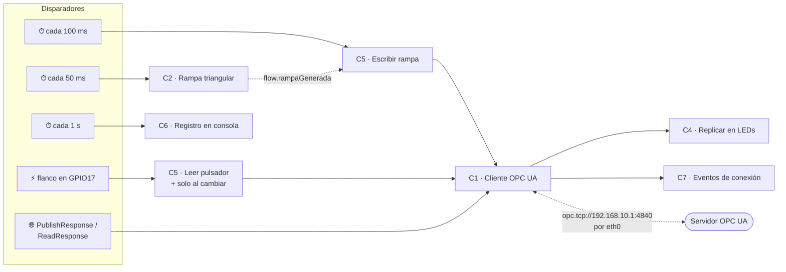
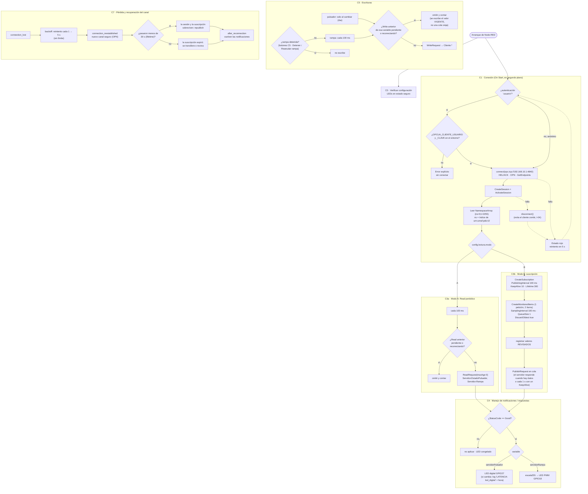

# Diagrama de flujo — Cliente OPC UA (Raspberry Pi 2)

**Autores:** Bevilacqua Francisco, Peralta Agustina

Cumple el requerimiento adicional 2 de la consigna: diagrama de flujo del
cliente (conexión, suscripción, manejo de notificaciones, escrituras y
reconexión ante pérdida del canal). La trazabilidad con el código está en §3.

## 1. Vista general

## 2. Bloques en detalle

Mientras el canal está caído no llegan datos: **C4 no recibe nada y los LED
quedan congelados en su último valor**, y el generador local (C2) sigue
funcionando. Es exactamente el comportamiento que pide la Parte 3.6, y sale del
diseño sin código adicional. C6 lo hace visible en la consola: la
`antiguedad` del último dato crece segundo a segundo.

Los umbrales de 30 s (suscripción) y 60 s (sesión) de C7 salen de
`config.suscripcion`. La prueba de desconexión de la Parte 3.6 se hace dos
veces, con cortes de menos y de más de 30 s, para observar las dos ramas.

## 3. Trazabilidad diagrama ↔ código

| Bloque | Function node en Node-RED | Archivo con el código | Función de biblioteca |
|---|---|---|---|
| C0 | `C0 · Verificar configuracion` | [comun/funciones/X1_verificar_config.js](../node-red/comun/funciones/X1_verificar_config.js) | — |
| C1 | `C1 · Cliente OPC UA` (On Start) | [cliente/funciones/C1_cliente_opcua.inicio.js](../node-red/cliente/funciones/C1_cliente_opcua.inicio.js) | `iniciarCliente()`, `prepararSesion()` en [cliente_opcua.js](../node-red/cliente/cliente_opcua.js) |
| C2 | `C2 · Generar rampa triangular` | [cliente/funciones/C2_generar_rampa.js](../node-red/cliente/funciones/C2_generar_rampa.js) | `senales.triangular()` |
| C3a / C3b | (dentro de C1) | `cliente_opcua.js`, bloques C3a y C3b | `session.read()`, `createSubscription2()`, `ClientMonitoredItemGroup.create()` |
| C4 | `C4 · Replicar en LEDs`, `C4 · LED digital`, `C4 · LED PWM` | [cliente/funciones/C4_replicar.js](../node-red/cliente/funciones/C4_replicar.js), [comun/funciones/X6_*.js](../node-red/comun/funciones/) | `senales.escala255()` |
| C5 | `C5 · Leer pulsador`, `C5 · Solo al cambiar`, `C5 · Escribir rampa`, botones `C5 · Detener/Reanudar rampa`; escritura en `C1` (On Message) | [comun/funciones/X4_leer_pulsador.js](../node-red/comun/funciones/X4_leer_pulsador.js), [cliente/funciones/C5_escribir_rampa.js](../node-red/cliente/funciones/C5_escribir_rampa.js), [C1_cliente_opcua.js](../node-red/cliente/funciones/C1_cliente_opcua.js) | `session.write()` |
| C6 | `C6 · Registro en consola` | [cliente/funciones/C6_consola.js](../node-red/cliente/funciones/C6_consola.js) | `node.log()` |
| C7 | `C7 · Eventos de conexion` | [cliente/funciones/C7_eventos.js](../node-red/cliente/funciones/C7_eventos.js) | eventos `connection_lost`, `backoff`, `after_reconnection` de `OPCUAClient` |
