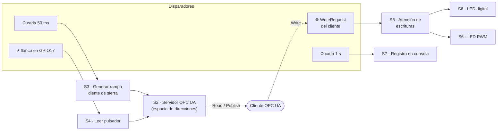
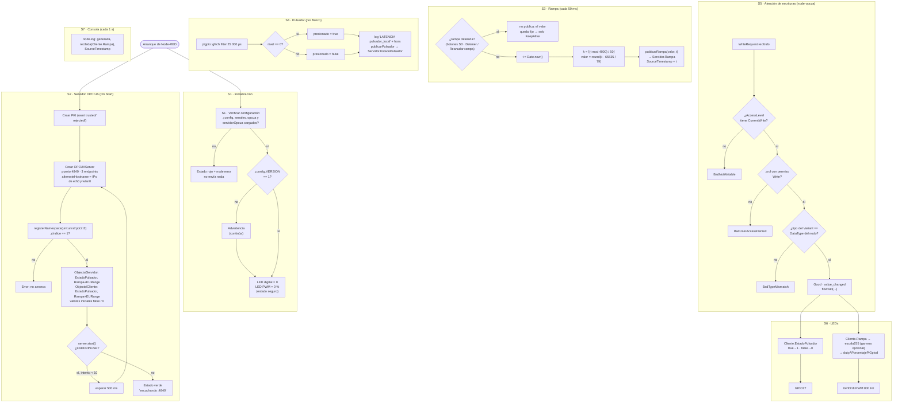

# Diagrama de flujo — Servidor OPC UA (Raspberry Pi 1)

**Autores:** Bevilacqua Francisco, Peralta Agustina

Cumple el requerimiento adicional 2 de la consigna: diagrama de flujo del
servidor (inicialización, creación del espacio de direcciones, generación de la
rampa, lectura del pulsador, atención de escrituras y manejo de LEDs). También
cumple el requerimiento 3 (trazabilidad de código): cada bloque nombra la
function node de Node-RED **con el mismo nombre** y el archivo que contiene su
código. `herramientas/prueba_flujos.js` verifica que la correspondencia se
mantenga.

## 1. Vista general: tareas concurrentes

En Node-RED no hay un `while True` como en el firmware de la Tarea 1. Hay
**cuatro disparadores independientes** (dos temporizadores, el GPIO y la red)
que el *event loop* de Node.js atiende de a uno por vez. Por eso ningún bloque
espera a otro: la rampa sigue generándose aunque no haya cliente conectado.

## 2. Bloques en detalle

Las validaciones de S5 las hace **node-opcua antes** de que el valor llegue al
código del trabajo: cuando se ejecuta `alEscribirCliente()` el valor ya es del
tipo correcto. La prueba de integración las verifica una por una (pruebas 4, 5
y 15).

## 3. Trazabilidad diagrama ↔ código

| Bloque | Function node en Node-RED | Archivo con el código | Función de biblioteca |
|---|---|---|---|
| S1 | `S1 · Verificar configuracion` | [comun/funciones/X1_verificar_config.js](../node-red/comun/funciones/X1_verificar_config.js) | — |
| S2 | `S2 · Servidor OPC UA` (On Start) | [servidor/funciones/S2_servidor_opcua.inicio.js](../node-red/servidor/funciones/S2_servidor_opcua.inicio.js) | `iniciarServidor()`, `construirEspacioDirecciones()` en [servidor_opcua.js](../node-red/servidor/servidor_opcua.js) |
| S2 | `S2 · Servidor OPC UA` (On Message) | [servidor/funciones/S2_servidor_opcua.js](../node-red/servidor/funciones/S2_servidor_opcua.js) | `publicarRampa()`, `publicarPulsador()` |
| S2 | `S2 · Servidor OPC UA` (On Close) | [servidor/funciones/S2_servidor_opcua.fin.js](../node-red/servidor/funciones/S2_servidor_opcua.fin.js) | `detener(0)` |
| S3 | `S3 · Generar rampa diente de sierra` | [servidor/funciones/S3_generar_rampa.js](../node-red/servidor/funciones/S3_generar_rampa.js) | `senales.sierra()` |
| S4 | `S4 · Leer pulsador` | [comun/funciones/X4_leer_pulsador.js](../node-red/comun/funciones/X4_leer_pulsador.js) | nodo `pi gpiod in` |
| S5 | (callback dentro de S2) | `alEscribirCliente` en S2_servidor_opcua.inicio.js | evento `value_changed` de node-opcua |
| S6 | `S6 · LED digital`, `S6 · LED PWM` | [comun/funciones/X6_led_digital.js](../node-red/comun/funciones/X6_led_digital.js), [X6_led_pwm.js](../node-red/comun/funciones/X6_led_pwm.js) | `senales.escala255()`, `senales.dutyAPorcentajePiGpiod()` |
| S7 | `S7 · Registro en consola` | [servidor/funciones/S7_consola.js](../node-red/servidor/funciones/S7_consola.js) | `node.log()` |

Los archivos `X*` son **comunes a ambas placas** (mismo código en el servidor y
en el cliente), igual que el único `main.py` de esclavo de la Tarea 1.
