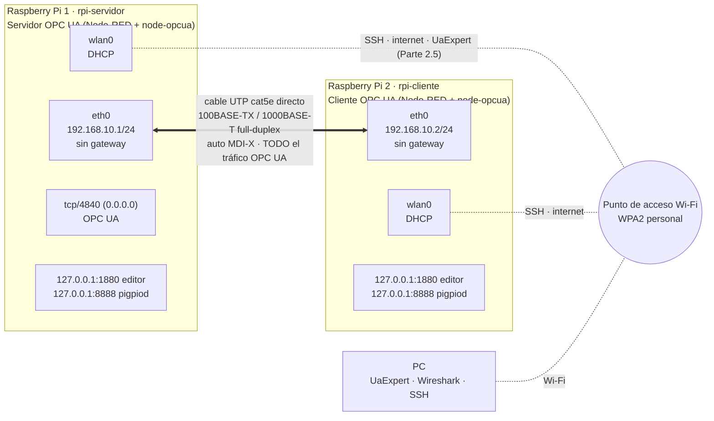

# Diagrama de red y conexionado

**Autores:** Bevilacqua Francisco, Peralta Agustina

Cumple el requerimiento adicional 1 de la consigna: esquema del enlace punto a
punto, con interfaces, direcciones IP y conexionado de los periféricos de cada
placa.

## 1. Red



| | RPi 1 · servidor | RPi 2 · cliente |
|---|---|---|
| `eth0` | 192.168.10.1/24, sin puerta de enlace, `never-default` | 192.168.10.2/24, sin puerta de enlace, `never-default` |
| `wlan0` | DHCP, ruta por defecto (internet) | DHCP, ruta por defecto (internet) |
| Puertos que escuchan | 22 (SSH), **4840 (OPC UA, todas las interfaces)**, 1880 y 8888 solo en loopback | 22 (SSH), 1880 y 8888 solo en loopback |
| Por dónde va el OPC UA | — | hacia 192.168.10.1 → ruta *directly connected* por `eth0` |

**Por qué el tráfico OPC UA va por `eth0` aunque la Wi-Fi esté activa:** el
cliente se conecta a `192.168.10.1`, que pertenece a la red conectada a
`eth0`. Para el kernel, la ruta más específica (192.168.10.0/24 por `eth0`)
gana sobre la ruta por defecto (0.0.0.0/0 por `wlan0`). La comprobación con
`ip route get`, `ss` y `tcpdump` está en [PARTE-1.md §4](../PARTE-1.md).

## 2. Conexionado de periféricos (idéntico en ambas placas)

```text
      Raspberry Pi (vista superior, pines impares a la izquierda)

               3V3  (1) (2)  5V
             GPIO2  (3) (4)  5V
             GPIO3  (5) (6)  GND ─────────────────────┐
             GPIO4  (7) (8)  GPIO14                   │
               GND  (9) (10) GPIO15                   │
   ┌──── GPIO17 (11) (12) GPIO18 ──[330Ω]──►|── LED PWM ┘
   │     GPIO27 (13) (14) GND ──────────────┐
   │        │                               │
   │        └──[330Ω]──►|── LED digital ────┘
   │
   └──o  o── pulsador ── GND (pin 9)
        (pull-up interno ~50 kΩ: suelto = 1, presionado = 0)
```

| Señal | GPIO (BCM) | Pin físico | Componentes | Nodo de Node-RED |
|---|---|---|---|---|
| Pulsador | 17 | 11 (y GND en 9) | Pulsador NA, sin resistencia externa | `S4/C5 · GPIO pulsador` (`pi gpiod in`, PUD_UP, glitch 25 000 µs) |
| LED digital | 27 | 13 (y GND en 14) | 330 Ω en serie | `S6/C4 · GPIO LED digital` (`pi gpiod out`, digital) |
| LED PWM | 18 | 12 (y GND en 6) | 330 Ω en serie | `S6/C4 · GPIO LED PWM` (`pi gpiod out`, PWM 800 Hz) |

Valores y justificación (corriente del LED, *pull-up*, frecuencia de PWM) en
[node-red/README.md §11](../node-red/README.md) y en `comun/config.js`.

## 3. Comparación con la Tarea 1

| | Tarea 1 · MODBus RTU | Tarea 2 · OPC UA |
|---|---|---|
| Medio | RS-485, par diferencial, bus multipunto half-duplex | Ethernet UTP, punto a punto full-duplex |
| Velocidad | 9600 baudios | 100 Mbit/s o 1 Gbit/s (negociado) |
| Direccionamiento | Unit ID por jumper (GPIO13) | IP estática por NetworkManager |
| Adaptación de niveles | Divisor 2,2 k/3,3 k (RO del MAX485 a 5 V) | No hace falta: el PHY Ethernet está integrado en la placa |
| Terminación | Analizada; innecesaria con 15-40 cm | Integrada en el PHY (100 Ω diferencial) |
| Quién habla | Un solo maestro, por turnos | Ambos extremos a la vez (full-duplex, sin colisiones) |

El desarrollo teórico de esta comparación está en
[docs/arquitectura-red.md §7](../docs/arquitectura-red.md).
