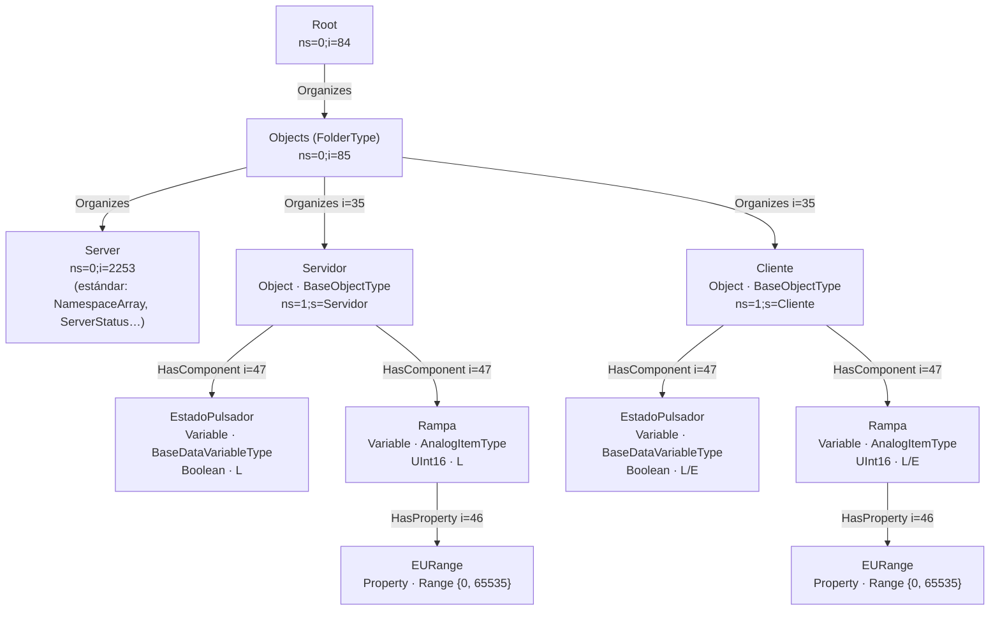

# Modelo de información y espacio de direcciones

**Tarea N.º 2 — OPC UA** · Protocolos de Comunicaciones Industriales · UNRaf
**Autores:** Bevilacqua Francisco, Peralta Agustina

Desarrolla el criterio de evaluación *"Modelo de información: tabla del espacio
de direcciones con NodeIds, tipos de datos, niveles de acceso y servicios OPC UA
utilizados"*, la Parte 2.2 y la **pregunta de análisis 6 de la Parte 2**. Cumple
el mismo papel que `tarea-1/docs/mapa-registros.md`: es el **contrato de
datos** entre servidor y cliente.

Los valores de las tablas no son de diseño sino **leídos del servidor real**
(Browse y Read sobre `servidor_opcua.js` con node-opcua 2.160.0). En el banco
se confirman con UaExpert (PARTE-2.md §5).

---

## 1. Conceptos: qué es cada elemento

| Elemento | Qué es | En este trabajo |
|---|---|---|
| **Servidor** | Aplicación que expone un espacio de direcciones y atiende servicios | Node-RED + `servidor_opcua.js` en la RPi 1 |
| **Cliente** | Aplicación que se conecta e invoca servicios | Node-RED + `cliente_opcua.js` en la RPi 2; UaExpert en la PC |
| **Endpoint** | Punto de acceso físico **y** lógico: URL + modo y política de seguridad + certificado + tipos de token de usuario aceptados | `opc.tcp://192.168.10.1:4840` × {None, Sign, SignAndEncrypt} |
| **Canal seguro** | Asociación entre **dos aplicaciones** que da integridad y confidencialidad a los mensajes (OPN/CLO) | SecureChannelId asignado por el servidor |
| **Sesión** | Asociación entre un **usuario** y el servidor, montada sobre un canal; guarda el estado: suscripciones, permisos, *continuation points* | CreateSession + ActivateSession |
| **Espacio de direcciones** | Conjunto de nodos que el servidor publica, unidos por referencias | §2 |
| **Nodo** | Elemento del espacio de direcciones. Tiene una **NodeClass** y un conjunto de **atributos** | 2 objetos, 4 variables, 2 propiedades |
| **Referencia** | Relación dirigida y tipada entre dos nodos (SourceNode → TargetNode) | Organizes, HasComponent, HasProperty, HasTypeDefinition |

La diferencia entre conexión TCP, canal seguro y sesión está en
[protocolo-opcua.md §4](protocolo-opcua.md).

## 2. El espacio de direcciones del trabajo



### 2.1 Tabla del espacio de direcciones

| NodeId | BrowseName | NodeClass | Tipo (HasTypeDefinition) | DataType | AccessLevel | Origen del dato | Servicios que la usan |
|---|---|---|---|---|---|---|---|
| `ns=1;s=Servidor` | `1:Servidor` | Object | BaseObjectType (i=58) | — | — | — | Browse |
| `ns=1;s=Servidor.EstadoPulsador` | `1:EstadoPulsador` | Variable | BaseDataVariableType (i=63) | Boolean (i=1) | **1** = CurrentRead | Pulsador de la RPi 1 | Read, CreateMonitoredItems, Publish |
| `ns=1;s=Servidor.Rampa` | `1:Rampa` | Variable | AnalogItemType (i=2368) | UInt16 (i=5) | **1** = CurrentRead | Generada por la RPi 1 | Read, CreateMonitoredItems, Publish |
| `ns=1;s=Servidor.Rampa-EURange` | `EURange` | Variable (Property) | PropertyType (i=68) | Range (i=884) | 1 | Constante {0, 65535} | Read |
| `ns=1;s=Cliente` | `1:Cliente` | Object | BaseObjectType (i=58) | — | — | — | Browse |
| `ns=1;s=Cliente.EstadoPulsador` | `1:EstadoPulsador` | Variable | BaseDataVariableType (i=63) | Boolean (i=1) | **3** = CurrentRead + CurrentWrite | Escrita por la RPi 2 | Write, Read |
| `ns=1;s=Cliente.Rampa` | `1:Rampa` | Variable | AnalogItemType (i=2368) | UInt16 (i=5) | **3** = CurrentRead + CurrentWrite | Escrita por la RPi 2 | Write, Read |
| `ns=1;s=Cliente.Rampa-EURange` | `EURange` | Variable (Property) | PropertyType (i=68) | Range (i=884) | 1 | Constante {0, 65535} | Read |

Atributos comunes a las cuatro variables: `ValueRank = −1` (escalar),
`MinimumSamplingInterval = 50 ms`, `Historizing = false`.

### 2.2 Por qué cada variable es lo que es

| Decisión | Justificación |
|---|---|
| **Objetos `Servidor` y `Cliente`, no carpetas** | Un Object agrupa variables que describen **una misma cosa** (el equipo que genera los datos), con referencias *HasComponent*. Una carpeta (FolderType, *Organizes*) solo ordena. Es la diferencia que la diapositiva 15 marca entre "Object" y "Node" |
| **Las variables se nombran por quién las genera, no por quién las lee** | `Cliente.Rampa` es la rampa **del cliente**, aunque la consuma el servidor. El nombre describe el origen del dato: así se lee la tabla de la consigna |
| **Rampa como AnalogItemType** | Es el tipo de *Data Access* (IEC 62541-8 §5.3.2) para magnitudes analógicas, y es el que define la propiedad **EURange** (rango de ingeniería). Un `BaseDataVariableType` no tiene dónde poner el rango de forma estándar |
| **UInt16** | La rampa va de 0 a 65 535 = 2¹⁶ − 1: es exactamente el rango del tipo. Un `Int32` o un `Double` desperdiciarían bytes en cada mensaje (2 contra 4 u 8) |
| **AccessLevel 1 en `Servidor.*`** | Los genera la RPi 1: escribirlos desde afuera no tiene sentido físico. El servidor rechaza el Write con **BadNotWritable** (prueba 4; consigna 2.5) |
| **NodeIds string fijos (`s=`)** | Pedido de la consigna. Son legibles en Wireshark y en UaExpert, y estables entre reinicios. Su costo en bytes se analiza en [protocolo-opcua.md §9](protocolo-opcua.md) |
| **MinimumSamplingInterval = 50 ms** | Es el período de generación. Muestrear más rápido que lo que el dato cambia no aporta información; el servidor revisa al alza cualquier SamplingInterval menor |
| **Valores iniciales `false` / `0`** | Sin ellos, el primer Read devolvería un Variant nulo. Es el estado seguro: pulsadores sueltos y rampas en cero |

### 2.3 AccessLevel: los bits

`AccessLevel` es una máscara de bits (IEC 62541-3 §5.6.2):

| Bit | Valor | Nombre | Significado |
|---|---|---|---|
| 0 | 1 | CurrentRead | Se puede leer el valor actual |
| 1 | 2 | CurrentWrite | Se puede escribir el valor actual |
| 2 | 4 | HistoryRead | Hay historia (no se usa) |
| 3 | 8 | HistoryWrite | (no se usa) |

`1` = solo lectura, `3` = lectura y escritura. `UserAccessLevel` es el mismo
concepto **para el usuario de la sesión**: con
`config.seguridad.soloAutenticadosEscriben = true`, el anónimo ve
`UserAccessLevel = 1` en `Cliente.*` aunque `AccessLevel` sea 3, y su Write
recibe **BadUserAccessDenied** (prueba de integración 15).

## 3. Los atributos de una variable (Parte 2.5)

Lo que la consigna pide documentar con UaExpert, leído del servidor real para
`Servidor.Rampa`:

| Atributo | Valor | Qué significa |
|---|---|---|
| NodeId | `ns=1;s=Servidor.Rampa` | Identificador único en el servidor: índice de namespace + identificador |
| BrowseName | `1:Rampa` | Nombre **calificado por namespace** que se usa para navegar y armar rutas (`TranslateBrowsePath`) |
| DisplayName | `Rampa` | Nombre para mostrar; puede estar localizado |
| DataType | `ns=0;i=5` (UInt16) | Tipo del Value: es un **nodo** del espacio de direcciones, no una etiqueta |
| AccessLevel | `1` (CurrentRead) | §2.3 |
| Value | el valor actual (por ejemplo `1234`) | Es un **DataValue**: valor + estado + marcas de tiempo |
| StatusCode | `Good` (0x00000000) | Calidad del dato. `Bad…` indica que el valor no es confiable |
| SourceTimestamp | instante de generación en la RPi 1 | Lo fija `setValueFromSource()` en S3 |
| ServerTimestamp | instante en que el servidor registró el valor | §6 |

## 4. Espacios de nombres (namespaces)

```text
Server.NamespaceArray (ns=0;i=2255) leído del servidor real:
  [0] http://opcfoundation.org/UA/     ← reservado: nodos estándar de la OPC Foundation
  [1] urn:unraf:pdci:t2                ← el modelo de este trabajo
```

- **El índice es local al servidor; la URI es la identidad.** `ns=1` significa
  "la URI en la posición 1 del NamespaceArray de **este** servidor". Otro
  servidor podría tener `urn:unraf:pdci:t2` en la posición 3. Por eso el
  cliente **no asume** `ns=1`: lee el NamespaceArray después de activar la
  sesión y busca la URI (`cliente_opcua.js`, IEC 62541-3 §8.2.2). En la captura
  es el ReadRequest que aparece justo después de ActivateSession
  ([secuencia_sesion.md](../diagramas/secuencia_sesion.md)).
- **Por qué queda en el índice 1.** node-opcua registra por defecto el
  `applicationUri` del servidor como namespace 1. Se usa
  `skipOwnNamespace: true` y se registra `urn:unraf:pdci:t2` a mano, de modo que
  ocupa el índice 1 que pide la consigna. El servidor verifica al arrancar que
  el índice sea 1 y, si no lo es, no arranca.
- **Separación de identidades.** El `applicationUri` (identidad de la
  **aplicación**, que va en el certificado X.509) queda como
  `urn:<hostname>:unraf:pdci:t2:servidor`, distinto de la URI del **modelo**.
  Son conceptos diferentes que es fácil confundir.

## 5. Servicios OPC UA utilizados

| Conjunto (IEC 62541-4) | Servicio | Quién lo usa | Para qué |
|---|---|---|---|
| Discovery | GetEndpoints | Cliente, UaExpert | Conocer URL, modos, políticas, certificado y tokens aceptados |
| SecureChannel | OpenSecureChannel / CloseSecureChannel | Ambos | Abrir y cerrar el canal (OPN/CLO) |
| Session | CreateSession, ActivateSession, CloseSession | Cliente, UaExpert | Sesión e identidad del usuario |
| View | Browse, TranslateBrowsePathsToNodeIds | UaExpert, pruebas | Recorrer el espacio de direcciones; encontrar la EURange |
| Attribute | **Read** | Cliente (Modo A), UaExpert | Lectura cíclica; NamespaceArray |
| Attribute | **Write** | Cliente, UaExpert | Escribir `Cliente.*` |
| Subscription | **CreateSubscription**, **Publish**, DeleteSubscriptions | Cliente (Modo B) | Recibir notificaciones |
| MonitoredItem | **CreateMonitoredItems** | Cliente (Modo B) | Elegir qué nodos y con qué muestreo |

## 6. SourceTimestamp y ServerTimestamp

IEC 62541-4 §7.11 define dos marcas de tiempo (diapositiva 22 del material):

- **SourceTimestamp:** cuándo el **origen** del dato produjo el valor (el
  dispositivo). Es la que importa para correlacionar eventos de planta.
- **ServerTimestamp:** cuándo el **servidor** recibió o actualizó el valor.

En un servidor que recolecta datos de un PLC remoto difieren por la latencia de
esa adquisición. En este trabajo el origen y el servidor son **el mismo
proceso**: node-opcua registra ambas en el mismo instante (verificado: en el
Read del servidor real valen lo mismo al milisegundo). La diferencia que sí se
puede medir es entre el SourceTimestamp y la hora de **recepción en el
cliente** (columna `antiguedad` de C6 en la consola), que es la latencia de
extremo a extremo si los relojes están sincronizados (node-red/README.md §14).

## 7. Pregunta 6: cliente-servidor OPC UA frente a maestro-esclavo MODBus

> *¿Qué diferencia conceptual existe entre el par cliente-servidor de OPC UA y
> el par maestro-esclavo de MODBus? ¿Qué ventaja aporta navegar el espacio de
> direcciones frente a conocer de antemano una tabla de registros?*

### 7.1 Diferencia conceptual

A primera vista son lo mismo: uno pregunta y el otro responde. MODBus TCP
incluso rebautizó a maestro y esclavo como *cliente* y *servidor*. La
diferencia está en **qué se intercambia y qué estado existe**:

| Aspecto | MODBus maestro-esclavo (Tarea 1) | OPC UA cliente-servidor (Tarea 2) |
|---|---|---|
| Qué expone el servidor | **Memoria cruda**: 4 tablas de bits y palabras de 16 bits sin significado | **Objetos** con tipo, nombre, unidad, rango y relaciones |
| Iniciativa | Solo el maestro habla; el esclavo **nunca** inicia nada | El cliente pide, pero con una suscripción el servidor **decide cuándo informar** (por cambio de valor) |
| Estado de la comunicación | Ninguno: cada transacción es independiente | **Con estado**: canal seguro, sesión, suscripciones y colas de notificaciones que sobreviven a cortes breves |
| Cantidad de "maestros" | Uno solo por bus (la Tarea 1 lo impuso por diseño) | Muchos clientes simultáneos (RPi 2 + UaExpert en este trabajo) |
| Un nodo puede ser ambos | No en el mismo bus | Sí: un servidor puede ser a la vez cliente de otro (diapositiva 11, *aggregating servers*) |
| Identidad | Unit ID de 1 byte | Certificado X.509 de aplicación + usuario |
| Calidad y tiempo del dato | No existen en el protocolo | Cada valor viaja con StatusCode y marcas de tiempo |
| Errores | 8 códigos de excepción | StatusCode de 32 bits con cientos de códigos (BadNotWritable, BadTypeMismatch…) |

**Síntesis:** MODBus es un protocolo de **transferencia de registros**; el
significado vive afuera, en un documento. OPC UA es un protocolo de
**intercambio de información**: el significado viaja con el dato y el servidor
lo describe. El maestro-esclavo es un diálogo sin memoria y de un solo sentido
de iniciativa; el cliente-servidor de OPC UA es una relación con estado, en la
que el servidor puede tomar la iniciativa dentro de una suscripción.

### 7.2 Ventaja de navegar el espacio de direcciones

En la Tarea 1, para que el maestro supiera que el potenciómetro era el *input
register* 30001 con escala 0-4095, hizo falta un documento (`mapa-registros.md`)
y que maestro y esclavo coincidieran en él. **Nada en el protocolo lo
confirmaba**: si el esclavo cambiaba el mapa, el maestro leía un número válido
con un significado equivocado, sin ningún error. Esa fue la clase de falla que
`mapa-registros.md` §5 tuvo que analizar a mano (el desfasaje Modicon ↔
offset).

Con OPC UA, un cliente que no conoce el servidor puede:

1. **Descubrir** qué hay (Browse desde Objects) y obtener nombres legibles.
2. **Leer el tipo** de cada variable (DataType = UInt16) y su rango
   (EURange = 0..65 535) **del propio servidor**, sin documentación externa.
3. **Saber qué puede hacer** (AccessLevel): el servidor rechaza con un error
   explícito lo que no corresponde, en lugar de aceptar en silencio.
4. **Resistir cambios**: si se agrega una variable, los clientes existentes no
   se rompen, porque nadie dependía de una posición numérica.

Es lo que permite que **UaExpert**, un cliente genérico que no sabe nada de
este trabajo, muestre el modelo completo y grafique `Servidor.Rampa` sin
configuración (Parte 2.5). El equivalente MODBus (QModMaster en la Tarea 1)
exigía cargar a mano dirección, función y cantidad de cada registro.

El costo es la **sobrecarga**: el nombre `ns=1;s=Cliente.Rampa` ocupa 20 bytes
en cada Write, contra los 2 bytes de la dirección de registro de MODBus
([protocolo-opcua.md §9](protocolo-opcua.md)). OPC UA compra
autodescripción con ancho de banda, y en Ethernet el ancho de banda sobra.

## 8. Referencias

International Electrotechnical Commission. (2020). *OPC Unified Architecture
— Part 3: Address space model* (IEC 62541-3:2020).

International Electrotechnical Commission. (2020). *OPC Unified Architecture
— Part 4: Services* (IEC 62541-4:2020).

International Electrotechnical Commission. (2020). *OPC Unified Architecture
— Part 8: Data access* (IEC 62541-8:2020).

Lange, J., Iwanitz, F., & Burke, T. J. (2010). *OPC: From data access to
unified architecture* (4.ª ed.). VDE Verlag.

Mahnke, W., Leitner, S.-H., & Damm, M. (2009). *OPC Unified Architecture*.
Springer. https://doi.org/10.1007/978-3-540-68899-0

Modbus Organization. (2012). *MODBUS application protocol specification
V1.1b3*. https://modbus.org
