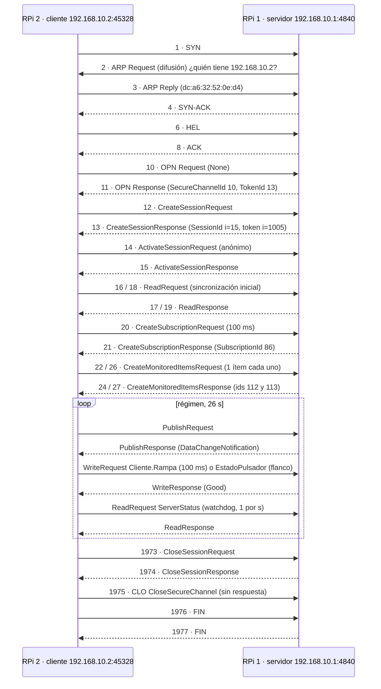

# Análisis de `capturas/captura_none.pcapng` — Parte 4 (v1, modo None)

Captura real del banco, tomada en `eth0` de la **RPi 2 (cliente)** con `tcpdump`, versión **v1**
(`servidor_ns1.py` + `cliente_suscripcion_v2.py`, asyncua 2.1.0). Decodificada con TShark 4.6.9.
Cada valor de este documento sale de la captura; el número de trama permite ubicarlo en Wireshark
(*Go → Go to Packet*, `Ctrl+G`).

| Dato | Valor |
|---|---|
| Duración / tramas / bytes | 26,2 s · **1978 tramas** · 240 265 bytes |
| RPi 1 · servidor | 192.168.10.1 · MAC `dc:a6:32:52:0e:78` · puerto **4840** |
| RPi 2 · cliente | 192.168.10.2 · MAC `dc:a6:32:52:0e:d4` · puerto efímero **45328** |
| Política / modo | `SecurityPolicy#None` · MessageSecurityMode None |

Ver también: [guia/04 Parte 4](../guia/04_resolucion_consignas.md#parte-4--análisis-de-tramas-y-seguridad) · comandos: [guia/COMANDOS.md](../guia/COMANDOS.md).

---

## 4.1 · La sesión está completa

| Etapa | Tramas | ✓ |
|---|---|---|
| Establecimiento TCP | 1 (SYN) · 4 (SYN-ACK) | ✓ |
| Resolución ARP | 2 (Request, difusión) · 3 (Reply) | ✓ |
| HEL / ACK | 6 · 8 | ✓ |
| OpenSecureChannel | 10 · 11 | ✓ |
| CreateSession / ActivateSession | 12 · 13 / 14 · 15 | ✓ |
| Read (sincronización inicial) | 16 – 19 | ✓ |
| CreateSubscription / CreateMonitoredItems | 20 · 21 / 22 · 24 y 26 · 27 | ✓ |
| Régimen: Publish, Write, Read (watchdog) | 23 – 1972 | ✓ |
| CloseSession / CloseSecureChannel | 1973 · 1974 / 1975 | ✓ |
| Cierre TCP | 1976 (FIN, cliente) · 1977 (FIN, servidor) | ✓ |

**Mensajes OPC UA por servicio** (`tshark … -Y opcua`):

| Servicio | Pedidos | Respuestas | Interpretación |
|---|---|---|---|
| Write | 275 | 275 | 260 de `Cliente.Rampa` (cada 100 ms × 26 s) + 15 de `Cliente.EstadoPulsador` (uno por flanco) |
| Publish | 263 | 262 | ≈ 10 por segundo: la rampa del servidor cambia siempre, así que cada ciclo de 100 ms trae datos. Queda un PublishRequest sin responder, que estaba pendiente al cerrar la sesión |
| Read | 28 | 28 | 2 de la sincronización inicial + 26 del *watchdog* de asyncua (1 por segundo) |
| CreateMonitoredItems | 2 | 2 | La v1 crea **un ítem por pedido** (dos llamadas a `subscribe_data_change`) |
| Resto | 1 c/u | 1 c/u | HEL, ACK, OPN ×2, CreateSession, ActivateSession, CreateSubscription, CloseSession, CLO |

## 4.2 · Secuencia de mensajes



**Observaciones para el informe (y la defensa):**

| Observación | Explicación |
|---|---|
| El SYN (1) sale **antes** del ARP y el ARP lo inicia el **servidor** | El cliente ya tenía en caché la MAC del servidor. El servidor, en cambio, no tenía la del cliente: antes de responder el SYN-ACK preguntó *Who has 192.168.10.2?* |
| **No hay GetEndpoints** | El cliente asyncua de la v1 no lo envía: toma los endpoints de la **CreateSessionResponse** (campo *ServerEndpoints*, trama 13: 1 endpoint `opc.tcp://192.168.10.1:4840`, modo None). Para mostrar GetEndpoints: capturar a UaExpert agregando el servidor, o usar la v2 |
| Reads después de ActivateSession | Sincronización inicial de la v1: lee el estado actual antes de suscribirse |
| Un Read por segundo en régimen | *Watchdog* del cliente asyncua (lee ServerStatus para detectar la caída del canal). No es parte del Modo B |
| No aparece ningún KeepAlive | Con MaxKeepAliveCount = 4500 (tabla de 3.4), el KeepAlive saldría cada 4500 × 100 ms = **450 s**. Además, la rampa cambia siempre: cada Publish trae datos |

## 4.3 · Conexión TCP, canal seguro y sesión: identificadores reales

| Capa | Se abre en | Identificador real | Vida (revisada) | Se cierra en |
|---|---|---|---|---|
| Conexión TCP | Tramas 1, 4 | 192.168.10.2:45328 ↔ 192.168.10.1:4840 | Mientras haya enlace | FIN, 1976 y 1977 |
| Canal seguro | OPN, 10 y 11 | **SecureChannelId 10**, **TokenId 13** (los lleva cada MSG) | RevisedLifetime **3 600 000 ms** (1 h) | CLO, 1975 |
| Sesión | CreateSession y ActivateSession, 12 – 15 | **SessionId ns=0;i=15**, **AuthenticationToken ns=0;i=1005** (va en el RequestHeader de cada pedido) | RevisedSessionTimeout **600 000 ms** (10 min) | CloseSession, 1973 y 1974 |

Las tres se cierran en orden inverso a como se abrieron: sesión → canal → TCP. Esto muestra que son capas
**independientes**, cada una con su identificador y su vida propia.

## 3.4 · Parámetros de la suscripción (pedidos frente a revisados)

| Parámetro | Pedido (trama 20/22) | Revisado por el servidor (21/24/27) | Consecuencia |
|---|---|---|---|
| PublishingInterval | 100 ms | **100 ms** | Un PublishResponse con datos cada 100 ms |
| LifetimeCount | 10 000 | **10 000** | 10 000 × 100 ms = 1000 s ≈ 16,7 min sin Publish antes de que el servidor borre la suscripción |
| MaxKeepAliveCount | 4500 | **4500** | KeepAlive cada 450 s (7,5 min): **no observable** en una captura de 60 s (la v2 usa 10 → 1 s) |
| SamplingInterval (por ítem) | 100 ms | **100 ms** (ítems 112 y 113) | Igual al de publicación |
| QueueSize (por ítem) | 1, DiscardOldest | **1** | Solo el último valor |
| ClientHandle | 201 (`Servidor.EstadoPulsador`), 202 (`Servidor.Rampa`) | — | Distintos: es la corrección de la v1 respecto de la primera versión |

## 4.4 · Encapsulamiento — PublishResponse con `Servidor.Rampa` (trama 35)

**204 bytes = 14 (Ethernet II) + 20 (IPv4) + 32 (TCP) + 138 (OPC UA).**

| Nivel | Campo | Valor real | Significado |
|---|---|---|---|
| **Ethernet II** | Destino | `dc:a6:32:52:0e:d4` | RPi 2: la respuesta va al cliente |
| | Origen | `dc:a6:32:52:0e:78` | RPi 1 |
| | EtherType | `0x0800` | IPv4 |
| **IPv4** | Versión / Header Length | 4 / **20 bytes** (IHL 5) | Sin opciones |
| | Total Length | 190 | 20 + 32 + 138 |
| | TTL / Protocolo | 64 / **6 (TCP)** | |
| | Origen → destino | 192.168.10.1 → 192.168.10.2 | |
| **TCP** | Puertos | **4840 → 45328** | Servidor OPC UA → puerto efímero del cliente |
| | Sequence / Acknowledgment (relativos) | 1596 / 1590 | Posición en el flujo de bytes de cada sentido |
| | Header Length / payload | **32 bytes** (8 × 4) / 138 | 20 fijos + 12 de la opción Timestamps (RFC 7323) |
| **OPC UA** | MessageType · Chunk · Size | MSG · F · **138** | Mensaje completo en un solo chunk |
| | SecureChannelId · TokenId | 10 · 13 | Canal de la trama 11 |
| | SequenceNumber · RequestId | 12 · **10** | RequestId = el de la PublishRequest que responde |
| | TypeId | i=**829** | PublishResponse |
| | NotificationMessage | SequenceNumber 2, PublishTime 18:30:08.843 | — |
| | DataChangeNotification (i=811) | **ClientHandle 202** → Variant UInt16 = **45090** | `Servidor.Rampa` = 45090 = 0xB022 → en el cable `22 b0` |

## 4.5 · Byte a byte

Se usan dos pares consecutivos de la captura, de t = 8,73 s: el pulsador de la RPi 2 en **true** y una
rampa distinta de cero, para mostrar la codificación de los dos tipos.

### WriteRequest `Cliente.Rampa` — trama 673 (173 B de trama · 107 B OPC UA)

```text
4d534746 6b000000 0a000000 0d000000 c1000000 c1000000 0100a102 0100ed03
2a1e665c5a66dd01 c1000000 00000000 ffffffff a00f0000 000000 01000000
03 0100 0d000000 436c69656e74652e52616d7061 0d000000 ffffffff
07 05 d52a 00000000 2e1a665c5a66dd01
```

| Offset | Bytes | Campo | Tipo | Valor | Significado |
|---|---|---|---|---|---|
| 0 | `4d 53 47` | MessageType | ASCII[3] | MSG | Mensaje de servicio |
| 3 | `46` | ChunkType | ASCII | F | Chunk final |
| 4 | `6b 00 00 00` | MessageSize | UInt32 LE | 107 | Bytes del mensaje, cabecera incluida |
| 8 | `0a 00 00 00` | SecureChannelId | UInt32 | 10 | Canal de la OPN |
| 12 | `0d 00 00 00` | TokenId | UInt32 | 13 | Cabecera de seguridad **simétrica** |
| 16 | `c1 00 00 00` | SequenceNumber | UInt32 | 193 | +1 por chunk enviado |
| 20 | `c1 00 00 00` | RequestId | UInt32 | 193 | Empareja con su respuesta |
| 24 | `01 00 a1 02` | TypeId | NodeId FourByte | ns=0;i=673 | **WriteRequest** (`a1 02` = 0x02A1 = 673, LE) |
| 28 | `01 00 ed 03` | AuthenticationToken | NodeId FourByte | ns=0;i=1005 | Token de la sesión (trama 13) |
| 32 | `2a 1e 66 5c 5a 66 dd 01` | Timestamp | DateTime | 2026-10-27 21:30:17.426897 UTC | Intervalos de 100 ns desde 1601-01-01 |
| 40 | `c1 00 00 00` | RequestHandle | UInt32 | 193 | Vuelve igual en la respuesta |
| 44 | `00 00 00 00` | ReturnDiagnostics | UInt32 | 0 | Sin diagnósticos |
| 48 | `ff ff ff ff` | AuditEntryId | String | nulo | Longitud −1 |
| 52 | `a0 0f 00 00` | TimeoutHint | UInt32 | 4000 | ms que espera el cliente |
| 56 | `00 00 00` | AdditionalHeader | ExtensionObject | vacío | — |
| 59 | `01 00 00 00` | NodesToWrite | Int32 (longitud) | 1 | Un WriteValue |
| 63 | `03` | NodeId · máscara | Byte | 0x03 = String | — |
| 64 | `01 00` | NodeId · namespace | UInt16 | 1 | ns=1 |
| 66 | `0d 00 00 00` | NodeId · longitud | Int32 | 13 | — |
| 70 | `43 6c … 61` | NodeId · texto | UTF-8 | `Cliente.Rampa` | **ns=1;s=Cliente.Rampa** |
| 83 | `0d 00 00 00` | AttributeId | UInt32 | 13 | **Value** |
| 87 | `ff ff ff ff` | IndexRange | String | nulo | Toda la variable |
| 91 | `07` | DataValue · máscara | Byte | 0x07 | Valor + StatusCode + SourceTimestamp |
| 92 | `05` | Variant · tipo | Byte | 5 | **UInt16** |
| 93 | `d5 2a` | Variant · valor | UInt16 **LE** | **10965** | 0x2AD5: el byte bajo (`d5`) va primero |
| 95 | `00 00 00 00` | StatusCode | UInt32 | 0 | Good |
| 99 | `2e 1a 66 5c 5a 66 dd 01` | SourceTimestamp | DateTime | 21:30:17.426795 UTC | Cuándo generó el valor la RPi 2 |

### WriteResponse `Cliente.Rampa` — trama 674 (130 B · 64 B OPC UA)

```text
4d534746 40000000 0a000000 0d000000 c0000000 c1000000 0100a402
a6b0665c5a66dd01 c1000000 00000000 00 00000000 000000 01000000 00000000 00000000
```

| Offset | Bytes | Campo | Valor | Significado |
|---|---|---|---|---|
| 0 | `4d 53 47 46` | MessageType + ChunkType | MSG F | — |
| 4 | `40 00 00 00` | MessageSize | 64 | — |
| 8 · 12 | `0a…` · `0d…` | SecureChannelId · TokenId | 10 · 13 | Mismo canal |
| 16 | `c0 00 00 00` | SequenceNumber | 192 | Secuencia **propia del servidor** |
| 20 | `c1 00 00 00` | RequestId | **193** | **= el del WriteRequest 673**: así se emparejan |
| 24 | `01 00 a4 02` | TypeId | i=676 | **WriteResponse** |
| 28 | `a6 b0 … dd 01` | ResponseHeader.Timestamp | 21:30:17.430647 UTC | Hora del servidor |
| 36 | `c1 00 00 00` | RequestHandle | 193 | Igual al pedido |
| 40 | `00 00 00 00` | ServiceResult | Good | El servicio se ejecutó |
| 44 | `00` | ServiceDiagnostics | vacío | — |
| 45 | `00 00 00 00` | StringTable | 0 elementos | — |
| 49 | `00 00 00` | AdditionalHeader | vacío | — |
| 52 | `01 00 00 00` | Results (longitud) | 1 | Un resultado por WriteValue |
| 56 | `00 00 00 00` | Results[0] | **Good** | La escritura fue aceptada |
| 60 | `00 00 00 00` | DiagnosticInfos | 0 elementos | — |

### WriteRequest `Cliente.EstadoPulsador` = true — trama 670 (181 B · 115 B OPC UA)

Igual al de la rampa hasta el offset 63. Difiere en:

| Offset | Bytes | Campo | Valor |
|---|---|---|---|
| 4 | `73 00 00 00` | MessageSize | 115 |
| 16 · 20 · 40 | `c0 00 00 00` | SequenceNumber · RequestId · RequestHandle | 192 |
| 66 | `16 00 00 00` | NodeId · longitud | 22 (`Cliente.EstadoPulsador`) |
| 100 | `07` | DataValue · máscara | Valor + StatusCode + SourceTimestamp |
| 101 | `01` | Variant · tipo | **Boolean** |
| 102 | `01` | Variant · valor | **true** (1 byte; `00` = false, ver trama 710) |
| 103 | `00 00 00 00` | StatusCode | Good |
| 107 | `b8 9f 65 5c 5a 66 dd 01` | SourceTimestamp | 21:30:17.423660 UTC |

Su **WriteResponse** es la trama **672** (64 B): RequestId **192**, Results[0] = Good. 107 + 9 (NodeId
más largo) − 1 (Boolean de 1 byte contra UInt16 de 2) = **115** ✓.

**Codificación (lo que pide 4.5):**

- **Word en little-endian:** UA Binary transmite primero el byte menos significativo. 10965 = `0x2AD5` →
  `d5 2a`. MODBus RTU, en cambio, es big-endian: `2a d5`.
- **Boolean:** ocupa **un byte completo**, `01` = true y `00` = false. No es un bit.

## 4.6 · Eficiencia con los tamaños medidos

| | OPC UA (tramas 673 + 674) | MODBus RTU FC 06 (Tarea 1) |
|---|---|---|
| Dato útil | 2 B (UInt16) | 2 B |
| Pedido | **173 B** → 2 / 173 = **1,16 %** | 8 B → **25 %** |
| Pedido + respuesta | 173 + 130 = **303 B** → **0,66 %** | 16 B → **12,5 %** |
| Tiempo del pedido en el medio | 173 × 8 bits / 1 Gb/s ≈ **1,4 µs** | 80 bits / 9600 baudios ≈ **8,3 ms** |

Coincide con el informe de Agustina. Del mensaje OPC UA, el NodeId `ns=1;s=Cliente.Rampa` ocupa 20 B
y el DataValue 16 B (con StatusCode y SourceTimestamp). Escribir solo el valor (máscara `0x01`)
ahorraría 12 B.

## Pendiente con esta versión (requiere v2)

- KeepAlive observable (3.4) y GetEndpoints en la sesión del cliente (4.2).
- Sign / SignAndEncrypt, certificados, latencia por modo y usuario y contraseña (4.7 – 4.9).
