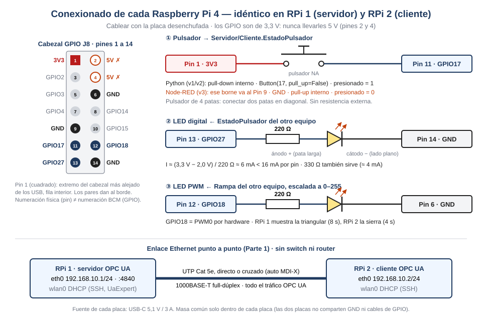
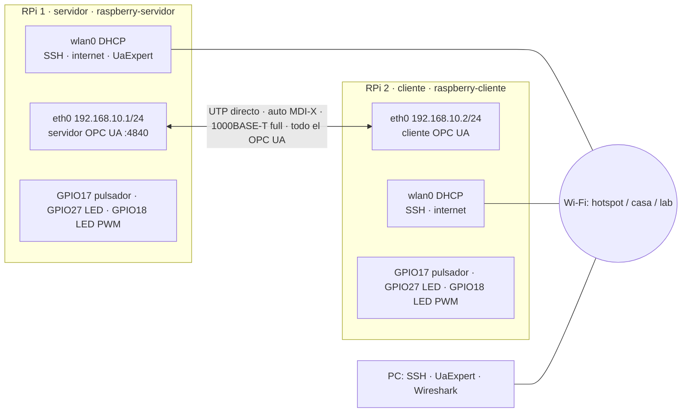

# 03 — Conexionado eléctrico

**Paso 3 de 4** · ← [02 — Cargar los programas](02_cargar_programas_SSH.md) · [Índice](README.md) · Siguiente → [04 — Resolución de las consignas](04_resolucion_consignas.md)

Cubre el **requerimiento adicional 1** de la consigna (diagrama de red con interfaces, IP y
conexionado de los periféricos). El conexionado es **idéntico en las dos placas**.



Archivo vectorial para el informe: [conexionado.svg](conexionado.svg) (abrir en el navegador →
imprimir a PDF, o exportar a PNG con Inkscape, libre).

---

## 1. Materiales (por placa)

| Cantidad | Elemento | Nota |
|---|---|---|
| 1 | Protoboard | — |
| 1 | Pulsador normal abierto (NA) | 4 patas: usar dos en **diagonal** |
| 2 | LED de 5 mm | Rojo o verde (V<sub>F</sub> ≈ 2 V). Azul/blanco se ven tenues |
| 2 | Resistencia 220 Ω (o 330 Ω) | Limitan la corriente del LED |
| 5 | Cables Dupont hembra-macho | Del cabezal a la protoboard |
| 1 (total) | Cable UTP Cat 5e | Entre las dos placas; directo o cruzado |

## 2. Lista de cables

| # | Desde (cabezal) | Hasta (protoboard) | Color sugerido | Función |
|---|---|---|---|---|
| 1 | Pin 1 · 3V3 | Pata A del pulsador | Rojo | Alimentación del pulsador (**v3 Node-RED: Pin 9 · GND**) |
| 2 | Pin 11 · GPIO17 | Pata B del pulsador (diagonal a A) | Amarillo | Entrada digital |
| 3 | Pin 13 · GPIO27 | Resistencia → ánodo LED digital | Verde | Salida digital |
| 4 | Pin 12 · GPIO18 | Resistencia → ánodo LED PWM | Azul | Salida PWM (canal PWM0 por hardware) |
| 5 | Pin 14 · GND (o 6) | Cátodos de los dos LED (fila común) | Negro | Masa |

| Señal | GPIO (BCM) | Pin físico | Dirección | Configuración en el código (v1/v2) |
|---|---|---|---|---|
| Pulsador | 17 | 11 | Entrada | `Button(17, pull_up=False, bounce_time=0.05)`: pull-down interno, antirrebote 50 ms |
| LED digital | 27 | 13 | Salida | `LED(27)` |
| LED PWM | 18 | 12 | Salida PWM | `PWMLED(18)`: `value` 0,0-1,0 = duty/255 |

Fuente: [`comun.py`](../versiones/v2-correccion-python/comun.py) (v2). v1 usa los mismos pines.

## 3. Justificación del circuito

| Decisión | Motivo |
|---|---|
| Resistencia 220 Ω en serie con cada LED | I = (3,3 V − V<sub>F</sub>) / R = (3,3 − 2,0) / 220 ≈ **5,9 mA**, debajo de los 16 mA recomendados por pin del BCM2711 y de los ~50 mA totales del banco de 3,3 V. Sin resistencia, el LED intenta tomar corriente sin límite y daña el pin |
| Pulsador a 3V3 con **pull-down interno** (Python) | Sin presionar, la resistencia interna (~50 kΩ) lleva el pin a 0; presionado, a 3,3 V → lógica positiva (`is_pressed` = 1). No hace falta resistencia externa. **Nunca** conectar el pulsador a 5 V |
| Pulsador a GND con **pull-up interno** (Node-RED) | Así lo configura v3 (`config.js`). Ventaja: un cable suelto deja el pin en "no presionado" (estado seguro) |
| Antirrebote 50 ms | Un contacto mecánico rebota 1-10 ms; 50 ms filtra el rebote y no se percibe como demora |
| GPIO18 para el PWM | Es el canal PWM0 por hardware: frecuencia estable aunque el CPU esté cargado |
| Masa común **dentro** de cada placa | Las placas solo se comunican por Ethernet (aislado galvánicamente por transformadores en cada PHY): no se unen GND ni GPIO entre placas |

## 4. Procedimiento

1. `pi$ sudo poweroff`, esperar a que el LED verde se apague y **desenchufar la fuente**.
2. Armar el circuito en la protoboard según la tabla del §2. Primero los componentes, después los
   cables al cabezal.
3. Revisar antes de energizar: ningún cable en los pines **2 o 4 (5 V)**, ánodo (pata larga) hacia la
   resistencia, cátodo (lado plano) a GND.
4. Enchufar la fuente y entrar por SSH.

## 5. Prueba del hardware (antes de usar OPC UA)

Aísla un problema eléctrico de uno de protocolo. En **cada** placa:

```bash
pi$ source ~/opcua-env/bin/activate
pi$ python - <<'EOF'
from gpiozero import Button, LED, PWMLED
from time import sleep
boton = Button(17, pull_up=False, bounce_time=0.05)   # v3 Node-RED: pull_up=True
led, pwm = LED(27), PWMLED(18)
print("LED digital encendido 1 s"); led.on(); sleep(1); led.off()
print("LED PWM de 0 a 100 % en 2 s")
for i in range(101):
    pwm.value = i / 100; sleep(0.02)
pwm.off()
print("Presionar el pulsador durante 10 s:")
for _ in range(100):
    print("  pulsador =", int(boton.is_pressed), end="\r"); sleep(0.1)
print()
EOF
```

| Falla | Causa probable | Solución |
|---|---|---|
| Un LED no enciende | Invertido, o resistencia en otra fila | Girar el LED; revisar las filas de la protoboard |
| El LED PWM no varía, solo enciende/apaga | Cable en el pin 13 en lugar del 12 | Revisar contra el §2 |
| El pulsador da siempre 0 | Patas del mismo lado (siempre unidas o nunca) | Usar patas en diagonal |
| El pulsador da siempre 1 | Pata a 3V3 conectada directo a GPIO17 | Revisar que el pulsador quede entre ambos |
| `GPIO busy` | Otro programa usa los pines | Cerrar el servidor/cliente (`Ctrl+C`) |

## 6. Diagrama de red (versión texto, para el informe)



Detalle y justificación de `ipv4.never-default`: [v2 diagramas/red.md](../versiones/v2-correccion-python/diagramas/red.md).

## ✅ Listo para seguir si…

- [ ] Las dos placas pasan la prueba del §5 (LED digital, LED PWM y pulsador).
- [ ] Foto de cada protoboard tomada (evidencia del conexionado para el informe).
- [ ] Cable Ethernet conectado entre las placas.

Siguiente → [04 — Resolución de las consignas](04_resolucion_consignas.md)
