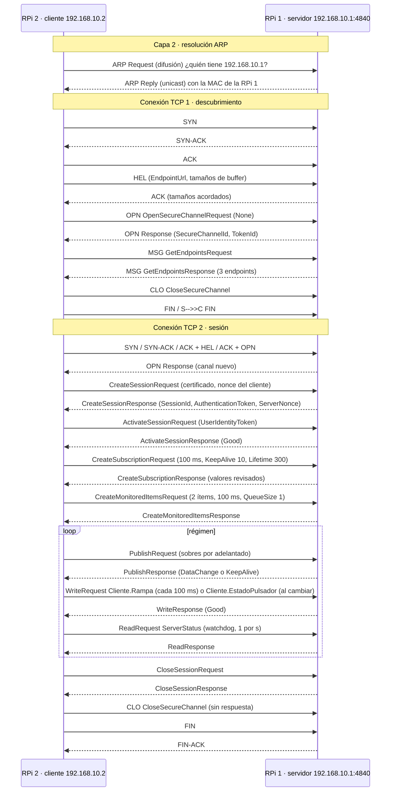

# 04 — Resolución paso a paso de la Tarea 2

**Paso 4 de 4** · ← [03 — Conexionado eléctrico](03_conexionado_electrico.md) · [Índice](README.md)

Todas las consignas de [Tarea_2_OPC_V26.pdf](../consigna/Tarea_2_OPC_V26.pdf), en el orden del
laboratorio, con **qué hacer**, **qué evidencia guardar** y **la respuesta justificada** de cada
pregunta. Versión de los programas: **v2** ([versiones/v2-correccion-python/](../versiones/v2-correccion-python/)).

Requisito: [01](01_instalar_SO_microSD.md), [02](02_cargar_programas_SSH.md) y [03](03_conexionado_electrico.md) terminados.
`RPi1$` = servidor · `RPi2$` = cliente · `PC>` = PowerShell en la raíz del repo · 📁 = evidencia · 🏠 = se puede hacer en casa.

| Índice | |
|---|---|
| [0. Organización](#0-organización-del-tiempo-y-la-evidencia) | Sesiones de banco, carpeta de evidencia |
| [Parte 1](#parte-1--red-ethernet-punto-a-punto) | Red Ethernet punto a punto (1.1 – 1.5) |
| [Parte 2](#parte-2--servidor-opc-ua-y-modelo-de-información) | Servidor y modelo de información (2.1 – 2.6) |
| [Parte 3](#parte-3--cliente-e-intercambio-bidireccional) | Cliente, Read vs suscripción, desconexión (3.1 – 3.7) |
| [Parte 4](#parte-4--análisis-de-tramas-y-seguridad) | Tramas, secuencia, byte a byte, seguridad (4.1 – 4.9) |
| [Requerimientos adicionales](#requerimientos-adicionales) | Diagramas, trazabilidad, capturas |
| [Informe y defensa](#informe-y-defensa) | Formato, guion de 12 min |
| [Referencias](#referencias-apa-7) | Bibliografía en APA 7 |

---

## 0. Organización del tiempo y la evidencia

| Sesión | Qué | Duración | Sale con |
|---|---|---|---|
| Banco 1 | Parte 1 + Parte 2 | ~2 h | Salidas de `ethtool`/`ip`/`ping`; capturas de UaExpert |
| Banco 2 | Parte 3 | ~3 h | 4 capturas `.pcapng` (A, B, A quieto, B quieto), registros, latencias, video de desconexión |
| Banco 3 | Parte 4 | ~2-3 h | Captura de sesión completa, 3 capturas por modo de seguridad, pruebas de usuario |
| 🏠 Casa | Análisis en Wireshark, tablas, diagramas, teoría, informe | — | Informe PDF |

**Todo lo que requiere placas se junta en el banco; el análisis se hace en casa** con las capturas.
Al final de cada sesión, copiar todo a la PC ([evidencia/](../evidencia/README.md)):

```powershell
PC> scp -r rpi1:TP2_OPC/registros evidencia\rpi1 ; scp -r rpi2:TP2_OPC/registros evidencia\rpi2
PC> scp "rpi2:*.pcapng" evidencia\capturas\
```

En cada placa, dentro de `tmux` ([02 §5](02_cargar_programas_SSH.md#5-sesiones-ssh-varias-terminales-y-tmux)):
panel izquierdo = programa, panel derecho = comandos.

---

## Parte 1 — Red Ethernet punto a punto

### 1.1 Conexión física

Cable UTP entre los `eth0` de las dos placas, **sin switch ni router**. Encender las dos.
📁 Foto del enlace con los LED del conector RJ45 encendidos.

### 1.2 Direccionamiento estático (NetworkManager / `nmcli`)

```bash
pi$ nmcli -f NAME,DEVICE connection show          # nombre del perfil de eth0
```

El perfil suele llamarse `netplan-eth0` (imagen actual) o `Wired connection 1` (Bookworm).

```bash
RPi1$ PERFIL="netplan-eth0"     # el que mostró el comando anterior
RPi1$ sudo nmcli connection modify "$PERFIL" ipv4.method manual ipv4.addresses 192.168.10.1/24 \
          ipv4.gateway "" ipv4.dns "" ipv4.never-default yes ipv6.method disabled connection.autoconnect yes
RPi1$ sudo nmcli connection up "$PERFIL"
RPi2$ # ídem con ipv4.addresses 192.168.10.2/24
```

| Parámetro | Valor | Justificación |
|---|---|---|
| `ipv4.method manual` | IP fija | No hay servidor DHCP en el enlace |
| `ipv4.addresses` | `.1/24` y `.2/24` | Tabla de la consigna; mismo prefijo 192.168.10.0/24 |
| `ipv4.gateway ""`, `ipv4.never-default yes` | sin ruta por defecto | Internet y SSH siguen por `wlan0`; por `eth0` solo va 192.168.10.0/24 (consigna 1.4) |
| `ipv6.method disabled` | — | Evita tráfico IPv6 (ND, MLD) que ensucia las capturas de la Parte 4 |
| `connection.autoconnect yes` | — | Persiste tras reiniciar |

📁 `nmcli connection show "$PERFIL" | grep -E "^ipv4\.(method|addresses|gateway|never)"` en cada placa
(documenta el procedimiento).

### 1.3 Verificación por capas (en las dos placas)

| Capa | Comando | Resultado esperado 📁 |
|---|---|---|
| Física | `ethtool eth0` | `Speed: 1000Mb/s`, `Duplex: Full`, `Auto-negotiation: on`, `Link detected: yes` |
| Física/enlace | `ip -br link show eth0` | `UP` y `<…,LOWER_UP>` (portadora presente); la MAC propia |
| Red | `ip addr show eth0` | `inet 192.168.10.1/24` (o `.2`) |
| Red | `ping -c 4 192.168.10.2` (desde RPi 1; al revés en RPi 2) | 4 recibidos, 0 % pérdida, RTT < 1 ms |
| Enlace | `ip neigh show dev eth0` | `192.168.10.x lladdr <MAC del otro> REACHABLE` |

Extra (muestra ARP en acción): `RPi2$ sudo ip neigh flush dev eth0; sudo tcpdump -i eth0 -e -n arp -c 2 & sleep 1; ping -c 1 192.168.10.1`
→ *Request who-has* a `ff:ff:ff:ff:ff:ff` y *Reply* unicast. 📁

### 1.4 Convivencia con Wi-Fi: demostrar que el OPC UA va por `eth0`

Hacer **con la Parte 3 funcionando** (cliente conectado). En la RPi 2:

| # | Comando | Esperado 📁 |
|---|---|---|
| 1 | `ip route` | `default via … dev wlan0` y `192.168.10.0/24 dev eth0 proto kernel scope link` |
| 2 | `ip route get 192.168.10.1` | `192.168.10.1 dev eth0 src 192.168.10.2` |
| 3 | `ss -tn \| grep 4840` | `ESTAB 192.168.10.2:<puerto> 192.168.10.1:4840` |
| 4 | `sudo timeout 10 tcpdump -i eth0 -n port 4840 \| wc -l` | Cientos de paquetes |
| 5 | `sudo timeout 10 tcpdump -i wlan0 -n port 4840 \| wc -l` | **0** |

**Por qué:** el cliente usa la IP literal `192.168.10.1` (no un nombre que podría resolverse por
Wi-Fi). El kernel elige la ruta por **coincidencia de prefijo más largo**: `192.168.10.0/24`
(24 bits, `eth0`) gana a `default` (0 bits, `wlan0`). `never-default` impide que `eth0` compita por
la ruta por defecto. La excepción es UaExpert en la Parte 2.5, que entra por la IP Wi-Fi de la RPi 1
porque la PC no está en el enlace.

### 1.5 Pregunta de análisis: red Ethernet punto a punto sin dispositivos intermedios

**Capa física.**
- *Cable:* UTP categoría 5e o superior con RJ-45. 1000BASE-T usa los 4 pares en ambos sentidos con
  cancelación de eco (IEEE 802.3, cl. 40); 100BASE-TX usa 2 pares (cl. 25).
- *Auto MDI-X:* en 10/100BASE-T dos equipos terminales (ambos MDI) necesitaban cable **cruzado** para
  que el transmisor de uno llegue al receptor del otro. Con auto MDI-X (IEEE 802.3 cl. 40.4.4) el PHY
  detecta en qué par recibe pulsos de enlace e intercambia TX/RX internamente: **cualquier cable
  sirve**. La Raspberry Pi 4 (PHY BCM54213PE) lo implementa.
- *Autonegociación* (cl. 28): cada PHY anuncia sus capacidades con ráfagas de *Fast Link Pulses* y
  ambos eligen el mejor modo común; entre dos Pi 4: **1000 Mb/s full-dúplex**. Si un extremo se fija
  a mano y el otro negocia, el que negocia asume half-dúplex → *duplex mismatch* (colisiones tardías,
  pérdida de rendimiento sin errores visibles). Por eso se deja activa en ambos extremos.

**Capa de enlace.**
- *MAC:* dirección de 48 bits única por interfaz (OUI de Raspberry Pi: `dc:a6:32`, `e4:5f:01`,
  `d8:3a:dd`). La trama Ethernet II lleva MAC destino, MAC origen y EtherType (0x0800 IPv4, 0x0806
  ARP). En full-dúplex no hay colisiones: CSMA/CD queda inactivo.
- *ARP* (RFC 826): traduce IP → MAC. La RPi 2 difunde *¿quién tiene 192.168.10.1?* a
  `ff:ff:ff:ff:ff:ff`; la RPi 1 responde en unicast con su MAC; ambas guardan la asociación en su
  tabla (`ip neigh`, estado `REACHABLE`). Sin ARP no se puede armar la trama del primer paquete.

**Capa de red.**
- *Direccionamiento estático:* sin DHCP en el enlace, cada interfaz recibe a mano una IP del mismo
  prefijo. Las direcciones de control se asignan y documentan, como los Unit ID de MODBus (Tarea 1).
- *Máscara /24* (255.255.255.0): 24 bits de red, 8 de equipo. Con `.1/24` y `.2/24` ambos están en
  192.168.10.0/24 (privada, RFC 1918) y el kernel crea una ruta *conectada* (`scope link`).
- *Sin puerta de enlace:* el gateway solo se usa para destinos **fuera** de las redes conectadas.
  El destino está en el propio prefijo: se resuelve su MAC por ARP y se le entrega la trama
  directamente. Un gateway en `eth0` además competiría con la ruta por defecto de `wlan0`.
- *Sin IP fija:* con DHCP y sin servidor, el equipo puede autoasignarse **169.254.x.y/16** (IPv4
  Link-Local, RFC 3927: elige al azar, comprueba con *ARP probes* y la anuncia). Dos equipos así
  podrían comunicarse, pero la dirección **cambia en cada arranque**: no sirve para un endpoint fijo
  `opc.tcp://192.168.10.1:4840` ni para un certificado. Además, NetworkManager por defecto no la
  configura: la interfaz queda sin IPv4.

**Herramienta por capa:**

| Capa | Herramienta | Qué verifica |
|---|---|---|
| 1 Física | `ethtool eth0`, `ip link` | Portadora, velocidad, dúplex, autonegociación |
| 2 Enlace | `ip link` (MAC), `ip neigh`, `tcpdump -e arp` | MAC propia y del vecino, resolución ARP |
| 3 Red | `ip addr`, `ip route`, `ip route get`, `ping` | Dirección, prefijo, ruta elegida, alcance |
| 4 Transporte | `ss -tlnp`, `ss -tn` | Puerto 4840 escuchando; conexión establecida |
| 7 Aplicación | UaExpert, Wireshark (`opcua`) | HEL/ACK/OPN/MSG |

Ampliación con bibliografía: [v3 docs/arquitectura-red.md §2](../versiones/v3-node-red/docs/arquitectura-red.md#2-pregunta-5-red-ethernet-punto-a-punto-sin-equipos-intermedios).

---

## Parte 2 — Servidor OPC UA y modelo de información

```bash
RPi1$ cd ~/TP2_OPC && ./iniciar.sh servidor.py
```

### 2.1 Servidor en `opc.tcp://192.168.10.1:4840`, escuchando en todas las interfaces

`RPi1$ ss -tlnp | grep 4840` → `LISTEN 0.0.0.0:4840`. 📁 Salida del arranque (3 endpoints, `ns=1`) y de
`ss`. Se usa **python-asyncua 2.1.0** (pila OPC UA en Python puro, asíncrona; misma lógica de
`asyncio` para servidor y cliente). `0.0.0.0` = todas las interfaces: `eth0` para el cliente y `wlan0`
para UaExpert.

### 2.2 Modelo de información con NodeIds fijos

Bloque S2 de [servidor.py](../versiones/v2-correccion-python/servidor.py). Tabla para el informe:

| Objeto | Variable | NodeId | DataType | AccessLevel | Origen | Propiedad |
|---|---|---|---|---|---|---|
| Servidor | EstadoPulsador | `ns=1;s=Servidor.EstadoPulsador` | Boolean (i=1) | 1 = CurrentRead | Pulsador RPi 1 | — |
| Servidor | Rampa | `ns=1;s=Servidor.Rampa` | UInt16 (i=5) | 1 = CurrentRead | Sierra RPi 1 | EURange 0..65535 (Range, i=884) |
| Cliente | EstadoPulsador | `ns=1;s=Cliente.EstadoPulsador` | Boolean | 3 = Read + Write | Escrita por RPi 2 | — |
| Cliente | Rampa | `ns=1;s=Cliente.Rampa` | UInt16 | 3 = Read + Write | Escrita por RPi 2 | EURange 0..65535 |

- Namespace `urn:unraf:pdci:t2` en **ns=1**: asyncua reserva el índice 1 para el ApplicationUri del
  servidor; usar esa URI como ApplicationUri deja el modelo en 1 (el servidor lo verifica al
  arrancar). Aplicación y modelo son conceptos distintos: se aclara en el informe.
- NodeIds de tipo **String** (`s=`): legibles y estables entre reinicios, independientes del orden de
  creación.
- **Servicios usados:** GetEndpoints, OpenSecureChannel, CreateSession, ActivateSession, Browse
  (UaExpert), Read, Write, CreateSubscription, CreateMonitoredItems, Publish, CloseSession,
  CloseSecureChannel.

### 2.3 Rampa del servidor: sierra 0 → 65535, período 4 s, actualización cada 50 ms

Bloque S3. Valor = `⌊65535 · (t mod 4 s) / 4 s⌋`, calculado **desde el reloj** (no con un contador): un
`sleep(0,05)` real dura algo más y un contador acumularía deriva. 80 muestras por período, paso ≈ 819.
📁 Se verifica en 2.5 c.

### 2.4 Salidas del servidor

Bloques S5/S6. LED digital = `Cliente.EstadoPulsador`; LED PWM = `round(Cliente.Rampa · 255 / 65535)`
→ `PWMLED.value = duty / 255`. Se actualizan **en el evento de escritura** (callback `PostWrite`), sin
sondeo. 📁 Se verifica en 2.5 d.

### 2.5 Verificación con UaExpert (PC, modo None)

| # | Hacer | Evidencia 📁 |
|---|---|---|
| a | `RPi1$ hostname -I` (IP Wi-Fi). UaExpert → *Add Server* → *Advanced* → `opc.tcp://<IP Wi-Fi>:4840`, **None / None**. Para navegar: *Anonymous*; para escribir: usuario `operador`. Si rechaza el certificado de UaExpert: `RPi1$ mv ~/TP2_OPC/pki/rechazados/*.der ~/TP2_OPC/pki/trusted/` y reconectar | `uaexpert_conexion.png` |
| b | *Address Space* → `Objects/Servidor` y `Objects/Cliente`; panel *Attributes* de cada variable | `uaexpert_atributos_<variable>.png` (×4): NodeId, BrowseName, DataType, AccessLevel, Value, StatusCode, SourceTimestamp, ServerTimestamp; `uaexpert_eurange.png` |
| c | Arrastrar `Servidor.Rampa` a *Data Access View* → *Document → Add → Trend View* | `uaexpert_tendencia_rampa.png`: diente de sierra, período 4 s |
| d | Escribir (como `operador`) `Cliente.EstadoPulsador` = true/false y `Cliente.Rampa` = 0, 32768, 65535 | Tabla valor → LED + foto/video |
| e | Escribir `Servidor.Rampa` | `uaexpert_solo_lectura.png` con **BadUserAccessDenied (0x801F0000)** |

**Sobre 2.5 e:** la especificación (IEC 62541-4) define `BadNotWritable` cuando el *AccessLevel*
impide escribir y `BadUserAccessDenied` cuando lo impide el *UserAccessLevel*. asyncua comprueba ambos
juntos y devuelve siempre el segundo: es un comportamiento de la biblioteca. Se registra y se
explica (node-opcua, en v3, sí devuelve `BadNotWritable`).

**Atributos:** *SourceTimestamp* = cuándo el **origen** generó el valor (lo pone quien escribe);
*ServerTimestamp* = cuándo el **servidor** lo registró. Su diferencia es la demora interna.

### 2.6 Pregunta de análisis: cliente-servidor OPC UA vs maestro-esclavo MODBus

**Diferencia conceptual.** Los dos son petición-respuesta, pero:

| Aspecto | MODBus maestro-esclavo (Tarea 1) | OPC UA cliente-servidor |
|---|---|---|
| Qué expone | Memoria cruda: registros de 16 bits sin significado | Objetos con nombre, tipo, rango, acceso y relaciones |
| Iniciativa | Solo el maestro; el esclavo nunca habla primero | El cliente pide, pero en una suscripción el **servidor decide cuándo informar** (por cambio) |
| Estado | Ninguno: cada transacción es independiente | Canal seguro, sesión y suscripciones con estado |
| Cantidad | Un maestro por bus | Varios clientes a la vez (RPi 2 + UaExpert) |
| Calidad y tiempo del dato | No existen | Cada valor viaja con StatusCode y marcas de tiempo |
| Seguridad | Ninguna | Certificados X.509, firma, cifrado, usuarios |

Síntesis: MODBus **transfiere registros** (el significado vive en un documento externo); OPC UA
**intercambia información** (el significado viaja con el dato y el servidor lo describe).

**Ventaja de navegar el espacio de direcciones.** Con MODBus el maestro debe conocer de antemano
dirección, función y escala de cada registro; si el mapa cambia, lee un número válido con otro
significado **sin ningún error**. Con OPC UA un cliente genérico puede *descubrir* (Browse) qué hay,
leer el tipo y el rango **del propio servidor**, saber qué puede escribir (AccessLevel, con error
explícito si no) y resistir cambios (agregar una variable no rompe a nadie). Evidencia propia:
**UaExpert, que no sabe nada de este trabajo, mostró el modelo completo y graficó `Servidor.Rampa`
sin configuración**. Costo: sobrecarga (el NodeId `ns=1;s=Cliente.Rampa` ocupa 20 bytes en cada Write
frente a 2 bytes de dirección en MODBus; ver 4.6).

---

## Parte 3 — Cliente e intercambio bidireccional

**Previo: sincronizar relojes** (para medir latencia en 3.4). La RPi 1 es servidor NTP por `eth0`:

```bash
RPi1$ echo -e "allow 192.168.10.0/24\nlocal stratum 8" | sudo tee /etc/chrony/conf.d/pdci-t2.conf && sudo systemctl restart chrony
RPi2$ echo "server 192.168.10.1 iburst prefer" | sudo tee /etc/chrony/conf.d/pdci-t2.conf && sudo systemctl restart chrony
RPi2$ sleep 30; chronyc tracking            # 📁 "System time" = error de sincronización (cota de la latencia)
```

Arranque: `RPi1$ ./iniciar.sh servidor.py` · `RPi2$ cd ~/TP2_OPC && ./iniciar.sh cliente_suscripcion.py`

### 3.1 Cliente conectado por `eth0`

Bloque C1 de [cliente_base.py](../versiones/v2-correccion-python/cliente_base.py): URL literal
`opc.tcp://192.168.10.1:4840`. 📁 `[C1] Sesion activa` en el registro + la prueba 1.4.

### 3.2 Rampa del cliente: triangular 0 → 65535 → 0, período 8 s, cada 50 ms

Bloque C2. 4 s de subida y 4 s de bajada, desde el reloj. **Las formas distintas prueban el origen
del dato**: el LED PWM de la RPi 2 sube y **cae de golpe** (sierra del servidor) y el de la RPi 1
**sube y baja suave** (triangular del cliente). 📁 Video corto de las dos placas.

### 3.3 Lógica de intercambio

| Sentido | Dato | Mecanismo | Prueba 📁 |
|---|---|---|---|
| RPi 1 → RPi 2 | `Servidor.EstadoPulsador` → LED digital RPi 2 | Modo A: Read · Modo B: notificación | Pulsar en RPi 1 → LED en RPi 2 |
| RPi 1 → RPi 2 | `Servidor.Rampa` → LED PWM RPi 2 | ídem | Brillo en sierra |
| RPi 2 → RPi 1 | Pulsador RPi 2 → `Cliente.EstadoPulsador` | Write **al cambiar** (evento de gpiozero) | Pulsar en RPi 2 → LED en RPi 1 |
| RPi 2 → RPi 1 | Rampa RPi 2 → `Cliente.Rampa` | Write **cada 100 ms** | Brillo triangular |

### 3.4 Lectura cíclica (Modo A) frente a suscripción (Modo B)

**Capturas de 60 s en la RPi 2** (arrancar el cliente, esperar 5 s y recién ahí capturar; segunda
terminal de `tmux`):

| Captura | RPi 1 | RPi 2 (programa) | RPi 2 (captura) |
|---|---|---|---|
| `captura_modo_A` | `./iniciar.sh servidor.py` | `./iniciar.sh cliente.py` | `sudo timeout 60 tcpdump -i eth0 -w ~/captura_modo_A.pcapng port 4840` |
| `captura_modo_B` | ídem | `./iniciar.sh cliente_suscripcion.py` | `… -w ~/captura_modo_B.pcapng …` |
| `captura_modo_A_quieto` | `./iniciar.sh servidor.py --rampa-detenida`, pulsadores en reposo | `./iniciar.sh cliente.py --sin-escritura` | `… -w ~/captura_modo_A_quieto.pcapng …` |
| `captura_modo_B_quieto` | ídem | `./iniciar.sh cliente_suscripcion.py --sin-escritura` | `… -w ~/captura_modo_B_quieto.pcapng …` |

**Conteo (🏠 en la PC, con `tshark`, que viene con Wireshark):**

```powershell
PC> tshark -r evidencia\capturas\captura_modo_A.pcapng -q -z io,stat,0          # tramas y bytes totales
PC> tshark -r evidencia\capturas\captura_modo_A.pcapng -Y opcua -T fields -e opcua.servicenodeid.numeric | Group-Object | Select-Object Count,Name
```

(631/634 Read, 673/676 Write, 826/829 Publish.) Más comandos:
[estadisticas_captura.md](../versiones/v3-node-red/herramientas/estadisticas_captura.md).

| Escenario (60 s) | Modo A: tramas / bytes | Modo B: tramas / bytes | B / A |
|---|---|---|---|
| Rampa en movimiento, escrituras activas | *medir* | *medir* | *calcular* |
| Rampa detenida, sin escrituras | *medir* | *medir* | *calcular* |

**Predicción** (medida en la PC con v2, 10 s; el banco debe dar proporciones parecidas): con
movimiento, B ≈ 100 % de los mensajes y ≈ 89 % de los bytes de A; quieto, B ≈ **17 % de los mensajes
y 11 % de los bytes**. Interpretación: con la rampa cambiando cada 50 ms, cada publicación de 100 ms
trae datos y B no ahorra mensajes (solo bytes: el PublishResponse lleva solo lo que cambió). Con el
proceso quieto, A sigue preguntando 10 veces por segundo y B envía 1 KeepAlive por segundo. En ambos
hay **1 Read de ServerStatus por segundo**: es el *watchdog* de asyncua para detectar la caída del
canal, no parte del Modo A (aclararlo al comparar).

**Parámetros de la suscripción** (documentar los *revisados* de la trama: `CreateSubscriptionResponse`
y `CreateMonitoredItemsResponse`; el cliente los imprime en `[C3]`):

| Parámetro | Pedido | Significado | Justificación |
|---|---|---|---|
| PublishingInterval | 100 ms | Cada cuánto el servidor arma un NotificationMessage | Lo pide la consigna |
| SamplingInterval | 100 ms | Cada cuánto el servidor mira el valor de cada ítem | Igual al de publicación: muestrear más rápido no se publicaría |
| QueueSize | 1 | Cambios guardados entre publicaciones (DiscardOldest) | Para un LED interesa el último valor, no la historia |
| MaxKeepAliveCount | 10 | Ciclos vacíos antes de un KeepAlive → 1 s | Hace visibles los KeepAlive en 60 s (el valor por defecto de asyncua da 7,5 min) |
| LifetimeCount | 300 | Ciclos sin PublishRequest antes de borrar la suscripción → 30 s | IEC 62541-4 exige ≥ 3 × MaxKeepAliveCount |

**Mecanismo PublishRequest / PublishResponse (respuesta).** OPC UA/TCP es petición-respuesta: el
servidor no puede enviar nada que no se le haya pedido. Por eso el cliente **deja PublishRequest
pendientes en el servidor** ("sobres" vacíos). Al vencer cada PublishingInterval, si algún ítem
cambió, el servidor responde una de esas peticiones con un PublishResponse que contiene una
`DataChangeNotification` (ClientHandle + DataValue de cada ítem que cambió) y el cliente repone el
sobre. Si no hubo cambios durante MaxKeepAliveCount ciclos, responde un **KeepAlive**: un
PublishResponse sin notificaciones. Sirve para que el cliente distinga "no hubo cambios" de "el
servidor murió" (silencio máximo = 1 s) y para que el servidor sepa que el cliente sigue vivo (si
dejan de llegar PublishRequest, cuenta hacia LifetimeCount). Cada PublishRequest además **confirma**
(SubscriptionAcknowledgement) la notificación anterior; hasta entonces el servidor la guarda para un
eventual Republish. 📁 En `captura_modo_B_quieto`, período entre PublishResponse ≈ 1 s:
`tshark -r … -Y "opcua.servicenodeid.numeric == 829" -T fields -e frame.time_relative`.

**Latencia pulsador → LED.** Las placas imprimen `LATENCIA pulsador_local=… t=…` en el flanco y
`LATENCIA led_digital=… t=…` al cambiar el LED. 20 pulsaciones por caso, en los dos sentidos y en
los dos modos:

```powershell
PC> python versiones\v3-node-red\herramientas\medir_latencia.py evidencia\rpi1\registros\servidor_X.log evidencia\rpi2\registros\cliente_Y.log   # RPi 1 → RPi 2
PC> python versiones\v3-node-red\herramientas\medir_latencia.py evidencia\rpi2\registros\cliente_Y.log evidencia\rpi1\registros\servidor_X.log   # RPi 2 → RPi 1
```

| Sentido | Modo | Mín | Mediana | p95 | Máx | Hipótesis |
|---|---|---|---|---|---|---|
| RPi 1 → RPi 2 | A | | | | | Uniforme entre ~0 y ~100 ms: espera al próximo Read |
| RPi 1 → RPi 2 | B | | | | | Uniforme entre ~0 y ~100 ms: espera al próximo ciclo de publicación |
| RPi 2 → RPi 1 | A/B | | | | | Pocos ms: el Write sale en el flanco y el servidor enciende al aceptarlo |

Cota de error: el `System time` de `chronyc tracking`.

### 3.5 Registro en consola

Ambos programas imprimen cada 0,5 s la rampa **generada**, la **recibida** y su **SourceTimestamp**
(`[S7]` servidor, `[C6]` cliente) y `iniciar.sh` lo guarda en `registros/`. 📁 Fragmento de 60 s de
cada placa.

### 3.6 Prueba de desconexión

Previo: con el cable desconectado, `RPi2$ ip route get 192.168.10.1` debe seguir saliendo por `eth0`.
Si sale por `wlan0` (NetworkManager quitó la ruta al perder portadora), agregar en las dos placas:
`sudo nmcli connection modify "$PERFIL" +ipv4.routes "192.168.10.0/24 type=prohibit metric=4000"` y
registrarlo como inconveniente.

Con Modo B en marcha, **tres cortes: ~5 s, ~20 s y ~45 s** (filmar las dos placas).

| Qué observar | Dónde 📁 |
|---|---|
| LED PWM de cada placa **congelado**; el generador local sigue | Video; `[C6] generada=` cambia y la línea termina en `SIN CONEXION (LED congelados)`; `[S7] generada=` cambia y `recibida` queda fija |
| StatusCode y hora | `[C3] Estado de la suscripcion: BadShutdown` y `[C7] TRANSPORTE TimeoutError` |
| Recuperación | `[C1] Conectando…` cada 2 s → `[C1] Sesion activa` → `[C3]` suscripción nueva |

**Respuesta para el informe.** Con el cable cortado **no llega ningún StatusCode del servidor**: el
cliente detecta la caída porque vence su *watchdog* (Read de ServerStatus cada 1 s sin respuesta) y
lo informa como error de transporte; la suscripción reporta `BadShutdown`. Al volver el enlace,
asyncua **abre un canal y una sesión nuevos y crea una suscripción nueva** (no reactiva la sesión
anterior: v3/node-opcua sí la reactiva con ActivateSession sobre un canal nuevo). La sesión vieja
queda en el servidor hasta su timeout (60 s) y su suscripción hasta el Lifetime (30 s). Un corte de
~5 s puede no producir ningún error: TCP retransmite antes de que venza el watchdog (resultado
válido, explicarlo). Los LED quedan en el último valor bueno: en OT se prioriza la **disponibilidad**
y la consigna lo pide.

### 3.7 Opcional: corrección gamma

`./iniciar.sh servidor.py --gamma` y `./iniciar.sh cliente_suscripcion.py --gamma`; comparar a simple
vista. brillo = 255 · (valor / 65535)^2,2.

**Justificación:** el PWM varía la luminancia de forma **lineal** con el ciclo de trabajo, pero el
ojo percibe el brillo de forma aproximadamente **potencial con exponente < 1** (ley de Stevens,
brillo percibido ∝ L^≈0,33-0,5; CIE L\*). Una rampa lineal parece subir muy rápido al principio y
quedarse "plana" arriba. Elevar a 2,2 (≈ inversa de la respuesta del ojo, la misma gamma de sRGB)
reparte los pasos de forma perceptualmente uniforme. Costo: con 8 bits, los primeros valores de la
rampa quedan en duty 0 (se pierde resolución abajo).

---

## Parte 4 — Análisis de tramas y seguridad

### 4.1 Captura de una sesión completa en modo None

El switch no reenvía el tráfico entre placas hacia la PC, y en el enlace directo la PC no
participa: se captura **en la RPi 2** y se analiza en la PC.

```bash
RPi1$ sudo ip neigh flush dev eth0
RPi2$ sudo ip neigh flush dev eth0                         # para que aparezca el ARP
RPi2$ sudo tcpdump -i eth0 -w ~/captura_none.pcapng &      # todo eth0 (incluye ARP)
RPi2$ ./iniciar.sh cliente_suscripcion.py                  # ~15 s; presionar los pulsadores
#     Ctrl+C  -> cierre ordenado (CloseSession, CLO, FIN)
RPi2$ sudo pkill tcpdump
PC>   scp rpi2:captura_none.pcapng evidencia\capturas\
```

Wireshark, filtro: `opcua || arp || tcp.flags.syn==1 || tcp.flags.fin==1`. 📁 `wireshark_sesion_none.png`.

### 4.2 Diagrama de secuencia

Versión v2 (asyncua). El cliente hace un descubrimiento explícito en una **primera conexión TCP** y
abre la sesión en una **segunda**. Verificar contra la captura propia y ajustar si difiere:



Origen de cada mensaje: `->>` lo envía el cliente, `-->>` el servidor.

### 4.3 Función de cada etapa y diferencia entre conexión TCP, canal seguro y sesión

| Etapa | Función |
|---|---|
| ARP | Obtener la MAC de 192.168.10.1 para armar la trama Ethernet |
| SYN / SYN-ACK / ACK | Sincronizar números de secuencia y abrir un flujo de bytes confiable |
| HEL / ACK | Acordar tamaños de buffer, de mensaje y de chunk; declarar la URL del endpoint |
| OPN | Crear el canal seguro: modo y política, *nonces* para derivar claves, SecureChannelId, TokenId, vida |
| GetEndpoints | Conocer endpoints, políticas, certificado del servidor y tokens de usuario aceptados |
| CreateSession | Crear la sesión: certificados y nonces, SessionId, AuthenticationToken, timeout |
| ActivateSession | Presentar la identidad del usuario y probar la posesión de la clave privada de la aplicación |
| CreateSubscription / CreateMonitoredItems | Definir cada cuánto publicar y qué nodos vigilar |
| Publish / Write / Read | Intercambio en régimen |
| CloseSession / CLO / FIN | Liberar sesión y suscripciones, luego el canal, luego la conexión |

| | Conexión TCP | Canal seguro | Sesión |
|---|---|---|---|
| Asocia | Dos sockets (IP:puerto) | Dos **aplicaciones** (certificados X.509) | Un **usuario** con el servidor |
| Se abre / cierra | SYN… / FIN | OPN / CLO | CreateSession + ActivateSession / CloseSession |
| Garantiza | Entrega ordenada y sin pérdida de bytes | Integridad (firma) y confidencialidad (cifrado) por mensaje | Autenticación y autorización del usuario; contexto (suscripciones) |
| Identificador | 4-tupla IP/puertos | SecureChannelId + TokenId | SessionId; AuthenticationToken en cada petición |
| Vida | Mientras haya enlace | RevisedLifetime (renovable con OPN *Renew*) | RevisedSessionTimeout sin actividad |

**Clave:** son capas **independientes**. La sesión no pertenece a un canal: si cae TCP y con él el
canal, la sesión sigue en el servidor hasta su timeout y puede **reactivarse** sobre un canal nuevo
(lo que hace node-opcua en v3; asyncua en v2 prefiere crear una nueva — ver 3.6).

### 4.4 Encapsulamiento de un PublishResponse con `Servidor.Rampa`

En `captura_modo_B`: filtro `opcua.servicenodeid.numeric == 829`, elegir uno que tenga
DataChangeNotification de la rampa → *Copy → …as Hex Stream* →

```powershell
PC> python versiones\v3-node-red\herramientas\opcua_tramas.py --ethernet --markdown "<hex>" > evidencia\tabla_publish.md
```

| Nivel | Campo | Valor esperado | Significado |
|---|---|---|---|
| Ethernet II (14 B) | MAC destino / origen | MAC RPi 2 / MAC RPi 1 | El PublishResponse va del servidor al cliente; las MAC son las de `ip neigh` |
| | EtherType | `0x0800` | IPv4 |
| IPv4 (20 B) | Versión/IHL | `0x45` | v4, cabecera de 5 × 4 = 20 B |
| | Total Length | 20 + TCP + OPC UA | Bytes del datagrama |
| | Flags / TTL / Protocolo | DF / 64 / 6 | No fragmentar; TTL de Linux; TCP |
| | Origen / destino | 192.168.10.1 → 192.168.10.2 | |
| TCP (32 B) | Puertos | origen **4840** → destino efímero del cliente | El 4840 identifica al servidor OPC UA |
| | Nº secuencia / acuse | relativos en Wireshark | Posición del primer byte enviado / próximo byte esperado del cliente |
| | Data offset / flags | 8 (32 B: 20 + 12 de **Timestamps**, RFC 7323) / PSH, ACK | Linux activa Timestamps por defecto |
| OPC UA | `MSG` `F`, MessageSize | — | Mensaje completo en un chunk |
| | SecureChannelId, TokenId, SequenceNumber, RequestId | — | RequestId = el de la PublishRequest que responde |
| | TypeId | `01 00 3d 03` = i=829 | PublishResponse |
| | Cuerpo | SubscriptionId, NotificationMessage → DataChangeNotification → MonitoredItemNotification (ClientHandle, DataValue con Variant UInt16 = rampa) | |

📁 `wireshark_publish_encapsulamiento.png` con el árbol expandido + la tabla generada.

### 4.5 Decodificación byte a byte: WriteRequest / WriteResponse

Elegir en `captura_none` un **WriteRequest de `Cliente.Rampa`** (filtro `opcua.servicenodeid.numeric == 673`,
el de 107 bytes de OPC UA) y su **WriteResponse** (676), y otro par de **`Cliente.EstadoPulsador`**
(115 bytes). Decodificar con `opcua_tramas.py --markdown "<hex>"` y presentar el volcado
hexadecimal con cada campo marcado.

**Estructura del WriteRequest** (v2/asyncua; la herramienta da los offsets exactos de cada trama):

| Offset | Bytes | Campo | Tipo | Valor / significado |
|---|---|---|---|---|
| 0 | 3 | MessageType | ASCII | `4d 53 47` = "MSG" |
| 3 | 1 | ChunkType | ASCII | `46` = "F" (final) |
| 4 | 4 | MessageSize | UInt32 LE | `6b 00 00 00` = 107 (incluye la cabecera) |
| 8 | 4 | SecureChannelId | UInt32 | Asignado por el servidor en el OPN |
| 12 | 4 | TokenId | UInt32 | Juego de claves vigente (cabecera de seguridad **simétrica**) |
| 16 | 4 | SequenceNumber | UInt32 | +1 por chunk: detecta pérdidas y repeticiones |
| 20 | 4 | RequestId | UInt32 | Empareja petición y respuesta |
| 24 | 4 | TypeId | NodeId FourByte | `01 00 a1 02` = ns=0;i=673 → WriteRequest |
| 28 | 2-4 | RequestHeader.AuthenticationToken | NodeId | Token de la sesión (TwoByte `00 xx` o FourByte `01 00 xx xx`) |
| | 8 | Timestamp | DateTime | Intervalos de 100 ns desde 1601-01-01 UTC |
| | 4 | RequestHandle | UInt32 | Lo elige el cliente; vuelve igual en la respuesta |
| | 4 | ReturnDiagnostics | UInt32 | 0 = sin diagnósticos |
| | 4 | AuditEntryId | String | `ff ff ff ff` = nulo (longitud −1) |
| | 4 | TimeoutHint | UInt32 | ms que el cliente está dispuesto a esperar |
| | 3 | AdditionalHeader | ExtensionObject | `00 00 00` = vacío |
| | 4 | NodesToWrite (longitud) | Int32 | `01 00 00 00` = 1 WriteValue |
| | 20 | NodeId | NodeId String | `03` (String) · `01 00` (ns=1) · `0d 00 00 00` (13) · "Cliente.Rampa" |
| | 4 | AttributeId | UInt32 | `0d 00 00 00` = 13 = Value |
| | 4 | IndexRange | String | `ff ff ff ff` = nulo |
| | 1 | DataValue.EncodingMask | Byte | `07` = Value (0x01) + StatusCode (0x02) + SourceTimestamp (0x04) |
| | 1 | Variant.EncodingMask | Byte | `05` = UInt16 |
| | 2 | Variant.Value | UInt16 LE | p. ej. 15586 = `0x3CE2` → `e2 3c` |
| | 4 | StatusCode | UInt32 | `00 00 00 00` = Good |
| | 8 | SourceTimestamp | DateTime | Momento en que la RPi 2 generó el valor |

Para `Cliente.EstadoPulsador`: NodeId de 29 bytes (`16 00 00 00` = 22 caracteres), Variant `01`
(Boolean) y **1 byte** de valor (`00` = false, `01` = true): 107 + 9 − 1 = **115 bytes**.

**WriteResponse (64 bytes):** cabecera `MSG F` + `40 00 00 00`, mismos SecureChannelId/TokenId,
**mismo RequestId**, TypeId `01 00 a4 02` (i=676), ResponseHeader (Timestamp 8, **RequestHandle igual
al pedido** 4, ServiceResult 4 = Good, ServiceDiagnostics 1, StringTable 4, AdditionalHeader 3),
Results = [1] con StatusCode `00 00 00 00` (Good) y DiagnosticInfos vacío.

**Codificación (respuesta):** UA Binary es **little-endian** (IEC 62541-6): la word 0x3CE2 viaja con el
byte menos significativo primero, `e2 3c` (al revés que MODBus, que es big-endian). El **Boolean**
ocupa **1 byte** (`00`/`01`), no un bit. Mejora posible: escribir solo el valor (máscara `0x01`)
ahorraría 12 bytes (StatusCode + SourceTimestamp), a costa de perder la hora de origen.

### 4.6 Eficiencia de la trama: una word

```powershell
PC> python versiones\v3-node-red\herramientas\eficiencia_trama.py --ua-bytes 107    # usar el MessageSize medido
```

| Componente | OPC UA / TCP (bytes) | MODBus RTU FC 06 (bytes) |
|---|---|---|
| Preámbulo + SFD / IFG | 8 + 12 | — (silencio t3,5) |
| Cabecera Ethernet II + FCS | 14 + 4 | — |
| IPv4 | 20 | — |
| TCP (con Timestamps) | 32 | — |
| Mensaje (cabeceras + parámetros) | 107 | Dirección 1 + Función 1 + Registro 2 + CRC 2 |
| **Dato útil** | **2** | **2** |
| **Total en el medio** | **197** | **8** |
| **Eficiencia** | **1,02 %** (1,16 % sobre la trama de Wireshark) | **25 %** (20 % contando bits 8N1) |
| Tiempo en el medio | 1,6 µs a 1000 Mb/s (15,8 µs a 100 Mb/s) | 11,98 ms a 9600 baudios |

**Discusión:** OPC UA es ~25 veces **menos eficiente en bytes**, pero la trama ocupa el medio
**miles de veces menos tiempo**, porque el medio es ~10⁵ veces más rápido. La sobrecarga es **fija
por mensaje**: se amortiza agrupando valores (un Write o un Publish con varios ítems). A cambio de
esos bytes se obtiene: direccionamiento por nombre, tipo, StatusCode, marca de tiempo, sesión y
seguridad, que MODBus no tiene. En Ethernet el ancho de banda sobra (10 Writes/s × 351 B por
transacción ≈ 3,5 kB/s ≈ 0,003 % de 1 Gb/s); en un bus RS-485 a 9600 baudios, no.

### 4.7 Tres endpoints: None, Sign y SignAndEncrypt (Basic256Sha256)

El servidor v2 ya los ofrece (se ven al arrancar y en GetEndpoints). **Procedimiento de confianza**
(es parte de la respuesta de 4.8):

1. `RPi2$ ./iniciar.sh cliente_suscripcion.py --seguridad Sign` → **rechazado**:
   `[C7] StatusCode=BadCertificateUntrusted`; en el servidor `[S1] Certificado NO confiable … SHA256=…`
   y el archivo en `pki/rechazados/`. 📁 ambas salidas.
2. Comparar huellas (fuera de banda):
   `RPi1$ openssl x509 -inform DER -in pki/rechazados/<archivo>.der -noout -fingerprint -sha256` y
   `RPi2$ openssl x509 -inform DER -in pki/own/cliente_cert.der -noout -fingerprint -sha256`. 📁
3. Si coinciden: `RPi1$ mv pki/rechazados/<archivo>.der pki/trusted/cliente_cert.der`.
4. Reintentar (sin reiniciar el servidor): conecta. Repetir con `--seguridad SignAndEncrypt`.

Capturas por modo (60 s, **Modo A con `--rampa-detenida`** en el servidor, así cada petición tiene una
sola respuesta): `captura_none`, `captura_sign`, `captura_signandencrypt` (`--seguridad None|Sign|SignAndEncrypt`).

### 4.8 Para cada modo: certificados, legibilidad y latencia

**Rol de los certificados X.509 de aplicación y trust list (respuesta).** Cada **aplicación** (no
cada persona) tiene un certificado X.509 v3 con su **clave pública**, su **ApplicationUri** en
*SubjectAltName* (debe coincidir con la que declara: un certificado robado no sirve para hacerse pasar
por otra aplicación) y su vigencia. La clave privada nunca sale del equipo (`pki/own/`). En el OPN
de Sign/SignAndEncrypt cada lado firma con su clave privada y cifra con la pública del otro (RSA); de
los *nonces* intercambiados ambos derivan las **mismas claves simétricas** sin transmitirlas, y desde
ahí cada MSG usa HMAC-SHA256 (firma, 32 B) y AES-256-CBC (cifrado). La **trust list** es la carpeta de
certificados en los que se confía (`pki/trusted/`): un certificado desconocido se rechaza y se guarda
aparte hasta que un administrador verifica su huella y lo mueve. Es una confianza **explícita y
manual**; en planta se usa una CA propia y un Global Discovery Server (IEC 62541-12). Aceptar
certificados automáticamente dejaría el canal cifrado… con un desconocido.

| Qué se ve en Wireshark 📁 | None | Sign | SignAndEncrypt |
|---|---|---|---|
| MessageType, ChunkType, MessageSize, SecureChannelId, TokenId | legible | legible | legible |
| SequenceNumber, RequestId | legible | legible | **cifrado** |
| Servicio (TypeId), RequestHeader, NodeId, valor | legible | legible | **cifrado** |
| Firma al final (32 B HMAC-SHA256) | — | sí | sí (dentro de lo cifrado) |
| OPN | en claro | firmado y cifrado con RSA (salvo la cabecera asimétrica) | ídem |
| GetEndpoints | legible | legible (canal None aparte) | legible (canal None aparte) |

**Sign protege la integridad, no la confidencialidad:** se puede leer el valor de la rampa, pero si se
modifica la firma no coincide y el receptor lo descarta. En control industrial suele ser lo
prioritario (IEC 62443). Con SignAndEncrypt solo se infiere **tamaño y ritmo** (análisis de tráfico).

**Latencia por modo** (🏠 en la PC):

```powershell
PC> tshark -r evidencia\capturas\captura_sign.pcapng -Y "tcp.port==4840 && tcp.len>0" -T fields -e frame.time_relative -e tcp.srcport -e tcp.len > campos_sign.tsv
PC> python versiones\v3-node-red\herramientas\latencia_captura.py campos_sign.tsv
```

| Modo | Latencia petición → respuesta (mediana / p95) | Tiempo de establecimiento (OPN → ActivateSession) |
|---|---|---|
| None | | |
| Sign | | |
| SignAndEncrypt | | |

Hipótesis: en régimen la diferencia es **< 1 ms** (HMAC y AES sobre ~100 B cuestan microsegundos en un
Cortex-A72); en el **establecimiento** es notoria (RSA-2048 en OPN y CreateSession).

### 4.9 Autenticación con usuario y contraseña, además del anónimo

| Prueba | Comando | Resultado esperado 📁 |
|---|---|---|
| Anónimo | `./iniciar.sh cliente.py --anonimo` | Lee; `Write … rechazado: BadUserAccessDenied`; la sesión sigue |
| Usuario correcto | `./iniciar.sh cliente.py` | Lee y escribe |
| Clave incorrecta | editar temporalmente `OPCUA_CLIENTE_CLAVE` en `~/.pdci-t2.env` | `[C7] StatusCode=BadUserAccessDenied` en ActivateSession; el servidor registra el usuario, nunca la clave |

**En qué mensaje viaja el token y cómo se protege (respuesta).** El token viaja en el
**ActivateSessionRequest**, campo `UserIdentityToken` (un ExtensionObject `UserNameIdentityToken`,
ns=0;i=324; el anónimo es i=321). El **nombre de usuario va legible**; la **contraseña va cifrada con
RSA-OAEP usando la clave pública del certificado del servidor**, concatenada con el **ServerNonce** que
el servidor envió en la CreateSessionResponse. Solo el servidor puede descifrarla, y el nonce impide
reenviarla en otra sesión (*replay*). Por eso, en v2, **aun con el canal en None la contraseña no
viaja en claro**: el endpoint None anuncia para el token la política Basic256Sha256 (verificar en
`captura_none`, campo `EncryptionAlgorithm` = `…rsa-oaep`). En SignAndEncrypt, además, todo el mensaje
va cifrado por el canal. 📁 `wireshark_activatesession_none.png`.

**Diseño de autorización:** anónimo = leer, navegar y suscribirse; `operador` = además escribir
(mínimo privilegio, IEC 62443-3-3 SR 2.1). Sin esta regla, autenticar no cambiaría nada. La clave se
guarda como **hash scrypt** (N = 2¹⁷, r = 8, p = 1, recomendación OWASP) y se compara en tiempo
constante.

---

## Requerimientos adicionales

| # | Requerimiento | Dónde |
|---|---|---|
| 1 | Diagrama de red: enlace, interfaces, IP y conexionado | [conexionado.svg](conexionado.svg) + [03 §6](03_conexionado_electrico.md#6-diagrama-de-red-versión-texto-para-el-informe) + fotos |
| 2 | Diagramas de flujo del servidor y del cliente | [flujo_servidor.md](../versiones/v2-correccion-python/diagramas/flujo_servidor.md) (S1-S7) · [flujo_cliente.md](../versiones/v2-correccion-python/diagramas/flujo_cliente.md) (C1-C7) |
| 3 | Trazabilidad de código | Cada sección del código está marcada `BLOQUE Sx` / `BLOQUE Cx`; tabla de trazabilidad al pie de cada diagrama. En el informe: fragmento de código → bloque |
| 4 | Capturas `.png` junto al informe | [evidencia/](../evidencia/README.md) |
| — | Librerías: parámetros, funciones con tipos y retorno | Tabla de funciones de asyncua y gpiozero en [v2 CONSIGNA.md](../versiones/v2-correccion-python/CONSIGNA.md#requerimientos-adicionales) |

## Informe y defensa

| Requisito | Valor |
|---|---|
| Archivo | PDF `Apellido1_Apellido2_Apellido3_PdCI_T2_26.pdf` |
| Formato | Arial 11, justificado, márgenes laterales 3 cm / superior e inferior 2,5 cm, interlineado 1,5, espaciado anterior 0 y posterior 6 |
| Citas | APA 7.ª edición ([Referencias](#referencias-apa-7)) |
| Contenido evaluado | Arquitectura de red y capa física (Parte 1) · modelo de información (2.2) · análisis de tramas: secuencia, encapsulamiento, byte a byte, seguridad (Parte 4) · diseño lógico y diagramas de flujo |
| Adjuntos | Código ([versiones/v2-correccion-python/](../versiones/v2-correccion-python/), **sin** `pki/` ni `~/.pdci-t2.env`), diagramas, capturas |
| Defensa | 12 min estrictos: apertura 2 + desarrollo 8 + cierre 2; **todos** hablan. Guion y banco de preguntas: [v3 defensa/guion.md](../versiones/v3-node-red/defensa/guion.md) |

La consigna menciona "canal IR", "RGB", "secuencia de colores" y "persistencia de datos": son restos
de otra tarea. Se defiende con el contenido real: intercambio pulsador/rampa ↔ LED, latencias,
Read vs suscripción, seguridad y recuperación ante desconexión.

**Demostración en vivo sugerida (3 min):** servidor + Modo B → pulsadores y rampas cruzadas (sierra en
RPi 2, triangular en RPi 1) → cortar el cable 20 s (LED congelados, `SIN CONEXION`, generador sigue)
→ reconectar (sesión nueva) → mostrar en Wireshark la captura SignAndEncrypt preparada.

## ✅ Lista final

- [ ] Parte 1: salidas de `nmcli`, `ethtool`, `ip`, `ping`, `ip neigh`; 5 pruebas de 1.4; respuesta 1.5.
- [ ] Parte 2: 3 endpoints y `ss`; tabla del modelo; 4 atributos + EURange + tendencia + escrituras + `BadUserAccessDenied`; respuesta 2.6.
- [ ] Parte 3: video de rampas; 4 capturas A/B; tabla de tramas/bytes; parámetros revisados; KeepAlive ≈ 1 s; latencias en 2 sentidos × 2 modos; registros 60 s; 3 cortes; (gamma).
- [ ] Parte 4: `captura_none` completa; diagrama de secuencia; tabla 4.3; encapsulamiento; 2 pares Write byte a byte; eficiencia vs MODBus; confianza de certificados; 3 capturas por modo con legibilidad y latencia; 3 pruebas de usuario.
- [ ] Requerimientos adicionales 1-4; tabla de librerías.
- [ ] Informe con el formato; ensayo de la defensa cronometrado.
- [ ] Declaración de uso de IA, si la cátedra la pide.

## Referencias (APA 7)

- Borman, D., Braden, B., Jacobson, V., & Scheffenegger, R. (2014). *TCP extensions for high performance* (RFC 7323). IETF. https://doi.org/10.17487/RFC7323
- Cheshire, S., Aboba, B., & Guttman, E. (2005). *Dynamic configuration of IPv4 link-local addresses* (RFC 3927). IETF. https://doi.org/10.17487/RFC3927
- IEEE. (2022). *IEEE standard for Ethernet* (IEEE Std 802.3-2022). IEEE Standards Association.
- International Electrotechnical Commission. (2020). *OPC Unified Architecture* (IEC 62541, partes 1-14). IEC.
- OPC Foundation. (s. f.). *OPC UA online reference*. Recuperado el 27 de octubre de 2026, de https://reference.opcfoundation.org/
- Plummer, D. C. (1982). *An Ethernet address resolution protocol* (RFC 826). IETF. https://doi.org/10.17487/RFC0826
- Protocolos de Comunicaciones Industriales. (2022). *OPC y OPC-UA* [Material de cátedra]. Universidad Nacional de Rafaela.
- Rekhter, Y., Moskowitz, B., Karrenberg, D., de Groot, G. J., & Lear, E. (1996). *Address allocation for private internets* (RFC 1918). IETF. https://doi.org/10.17487/RFC1918
- Stevens, S. S. (1957). On the psychophysical law. *Psychological Review, 64*(3), 153-181. https://doi.org/10.1037/h0046162

Bibliografía ampliada por tema: secciones *Referencias* de [v3 docs/](../versiones/v3-node-red/docs/).
