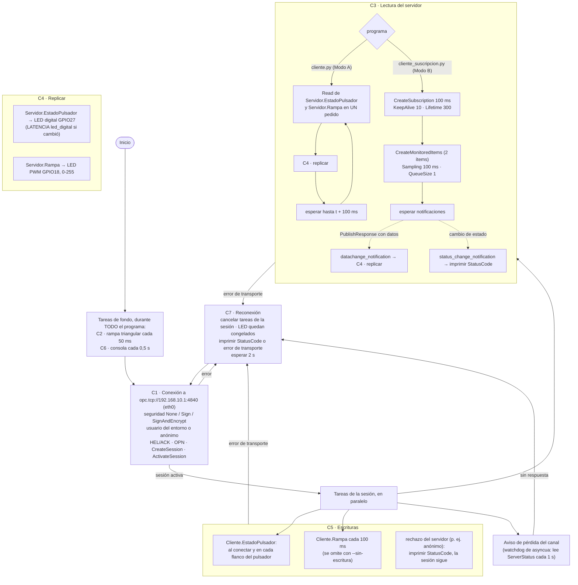

# Diagrama de flujo — Cliente (Raspberry Pi 2, `cliente.py` y `cliente_suscripcion.py`)

Requerimiento adicional 2 de la consigna. Los bloques **C1…C7** están marcados
con el mismo nombre en el código. Los dos programas comparten todo salvo **C3**
(cómo se lee el servidor), que es justamente lo que la consigna 3.4 compara.

## Trazabilidad diagrama ↔ código

| Bloque | Dónde | Consigna |
|---|---|---|
| C1 | [cliente_base.py](../cliente_base.py) `conectar`, `nodos_del_modelo` | 3.1, 4.7, 4.9 |
| C2 | `cliente_base.tarea_rampa` (+ `comun.rampa_triangular`) | 3.2 |
| C3 Modo A | [cliente.py](../cliente.py) `leer_por_polling` | 3.3, 3.4 |
| C3 Modo B | [cliente_suscripcion.py](../cliente_suscripcion.py) `leer_por_suscripcion`, `ManejadorSuscripcion` | 3.3, 3.4 |
| C4 | `cliente_base.replicar` (+ `comun.Salidas`) | 3.3, 3.6 (congelar) |
| C5 | `cliente_base.Escritor`, `tarea_escribir_pulsador`, `tarea_escribir_rampa` | 3.3 |
| C6 | `cliente_base.tarea_consola` | 3.5 |
| C7 | `cliente_base.ejecutar_sesion`, `correr_hasta_falla`, `main` | 3.6 |

## Diferencias con la versión original

| Antes | Ahora | Por qué |
|---|---|---|
| Modo A: dos Read de un nodo | Un Read con los dos nodos | No duplicar el tráfico del Modo A (comparación justa) |
| Suscripción con los valores por defecto de asyncua (KeepAlive 4500 = 7,5 min) | KeepAlive 10, Lifetime 300, revisados impresos | Ver KeepAlive en 60 s (3.4) y explicar la vida de la suscripción |
| Generador local y consola dentro de la sesión | Tareas de fondo | Durante el corte la rampa local sigue y se ve en consola (3.6) |
| Solo el tipo de excepción | StatusCode del servidor o error de transporte, con hora | Consigna 3.6 |
| Lectura inicial antes de suscribir | Eliminada | El servidor siempre envía la notificación inicial |
| Pulsador sondeado cada 100 ms | Evento de gpiozero | Latencia medible (3.4) |
