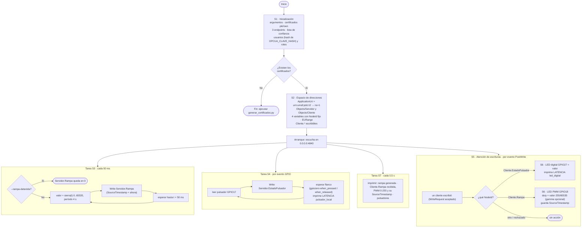

# Diagrama de flujo — Servidor (Raspberry Pi 1, `servidor.py`)

Requerimiento adicional 2 de la consigna. Los bloques **S1…S7** están marcados
con el mismo nombre en el código (requerimiento adicional 3).

El servidor no es un bucle único: después de arrancar corren **tres tareas
concurrentes** (S3, S4, S7) y **un manejador por evento** (S5 → S6) que asyncua
llama cuando un cliente escribe.

## Trazabilidad diagrama ↔ código

| Bloque | Función en [servidor.py](../servidor.py) | Consigna |
|---|---|---|
| S1 | `leer_argumentos`, `configurar_seguridad`, `GestorUsuarios`, `ReglasPorRol`, `ListaDeConfianza`, `clave_valida` | 2.1, 4.7, 4.8, 4.9 |
| S2 | `crear_modelo`, `agregar_eurange` | 2.2 |
| S3 | `tarea_rampa` (+ `comun.rampa_diente_sierra`) | 2.3, 3.4 (rampa detenida) |
| S4 | `tarea_pulsador` (+ `comun.Pulsador`) | 2.2 (origen del dato) |
| S5 | `crear_atencion_escrituras` → `al_escribir` | 2.4, 2.5 |
| S6 | `comun.Salidas.led_digital`, `comun.Salidas.led_pwm`, `comun.escalar_a_pwm` | 2.4, 3.7 |
| S7 | `tarea_consola` | 3.5 |

## Diferencias con la versión original (`servidor_ns1.py`)

| Antes | Ahora | Por qué |
|---|---|---|
| Un bucle de 50 ms hacía todo (sondeo) | Tareas concurrentes + evento de escritura | El LED reacciona al Write, no hasta 50 ms después; el pulsador no pierde pulsaciones breves |
| `sleep(0.05)` fijo | Programación sobre tiempos absolutos | Sin deriva del período |
| Solo endpoint None; cualquier usuario y clave aceptados | 3 endpoints, confianza de certificados, hash scrypt, anónimo de solo lectura | Parte 4 (4.7–4.9) |
| Consola sin SourceTimestamp | Con SourceTimestamp del dato recibido | Consigna 3.5 |
