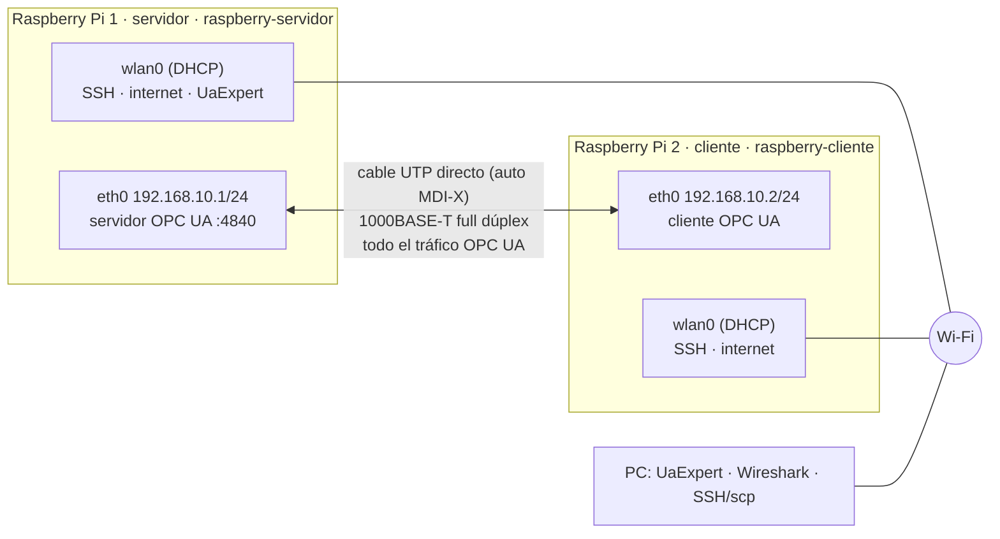

# Diagrama de red y conexionado

Requerimiento adicional 1: enlace punto a punto con interfaces, direcciones IP
y conexionado de los periféricos de cada placa.



- Sin gateway ni DNS en `eth0` (`ipv4.never-default yes`): la ruta por defecto
  queda en `wlan0` y por `eth0` solo va 192.168.10.0/24.
- UaExpert (2.5) llega al servidor por la IP **Wi-Fi** de la RPi 1. El cliente
  de la RPi 2 usa siempre la IP de `eth0` (literal, no un nombre de host).

## Conexionado de cada placa (idéntico en las dos)

| Periférico | Conexión | GPIO (BCM) | Pin físico |
|---|---|---|---|
| Pulsador | 3,3 V (pin 1) → pulsador → GPIO17. **Pull-down interno** (`Button(17, pull_up=False)`): sin resistencia externa | 17 | 11 |
| LED digital | GPIO27 → 220 Ω → ánodo LED; cátodo → GND | 27 | 13 |
| LED PWM | GPIO18 → 220 Ω → ánodo LED; cátodo → GND | 18 | 12 |
| Masa | GND común de protoboard | — | 6 / 9 / 14 |

```
3V3    (pin 1)  ──[ pulsador ]──────────── GPIO17 (pin 11)   pull-down interno
GPIO27 (pin 13) ──[ 220 Ω ]──▶|─────────── GND    (pin 9)    LED digital
GPIO18 (pin 12) ──[ 220 Ω ]──▶|─────────── GND    (pin 6)    LED PWM
```

Corriente por LED: (3,3 V − ~2 V) / 220 Ω ≈ 6 mA, debajo de los 16 mA por pin
del BCM2711. En un pulsador de 4 patas, 3,3 V y GPIO17 van en **lados
opuestos** (si no, el pin lee siempre 0: problema ya encontrado en el banco).
