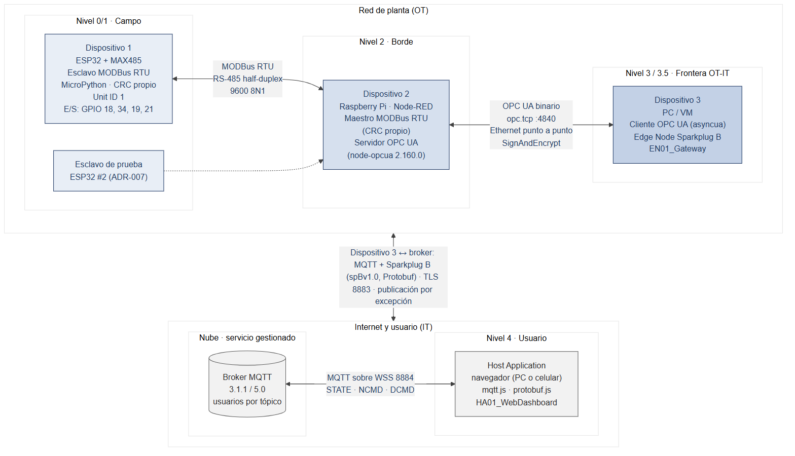
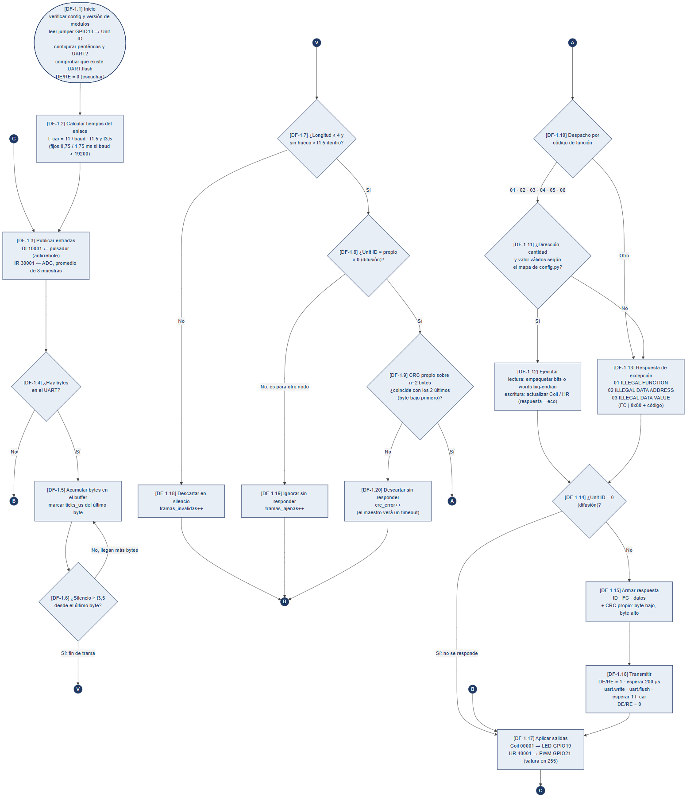
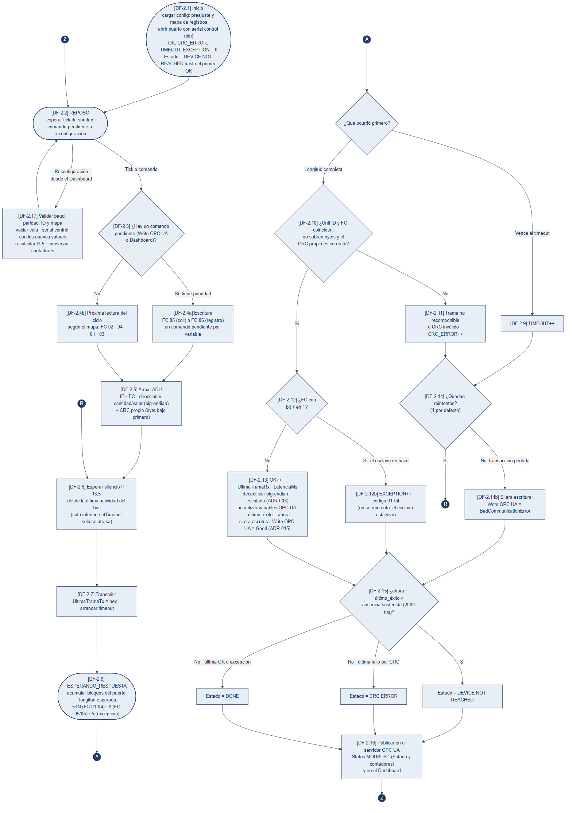
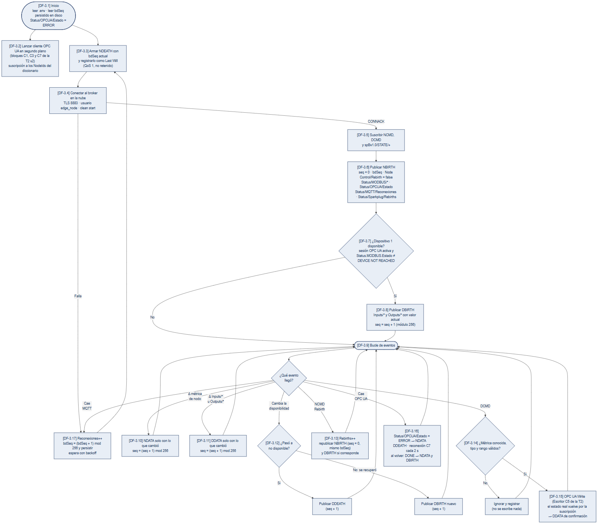
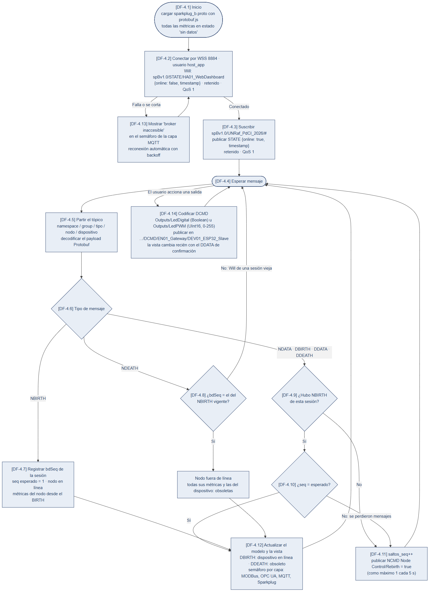
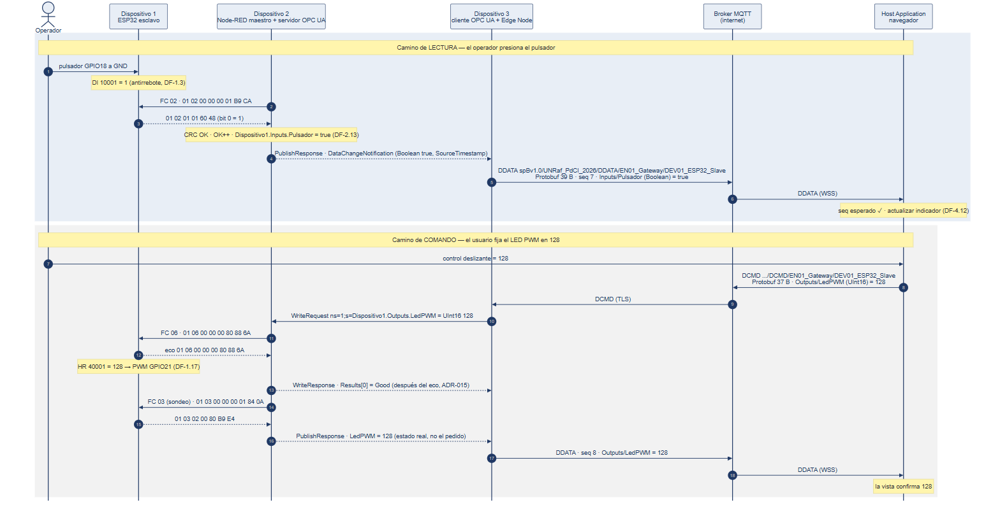

Universidad Nacional de Rafaela Ingeniería en Computación · 4.º año Protocolos de Comunicaciones Industriales

Tarea Nº3 — Integradora

Informe preliminar Diseño de la cadena MODBus RTU → OPC UA → MQTT / Sparkplug B

<strong>Autores:</strong> Bevilacqua, Francisco · Peralta, Agustina 
<strong>Docentes:</strong> Mg. Ing. Martín Pico · Ing. Milton Pozzo 
2.º cuatrimestre de 2026 · Rafaela, 9 de noviembre de 2026

# 1. Introducción y alcance

El presente informe preliminar describe cómo se resolverá la Tarea Nº3: una cadena de comunicación
de extremo a extremo que lleva el estado de las entradas y salidas de un dispositivo de campo hasta
un navegador web y devuelve órdenes del usuario hasta los actuadores, atravesando tres protocolos
industriales. El dispositivo 1, un microcontrolador ESP32, es el esclavo MODBus RTU construido en la
Tarea Nº1 [@bevilacqua2026t1]. El dispositivo 2, una Raspberry Pi con Node-RED, actúa como maestro
MODBus y, a la vez, como servidor OPC UA. El dispositivo 3, una PC, ejecuta el cliente OPC UA de la
Tarea Nº2 [@bevilacqua2026t2] y publica los datos como Edge Node de Sparkplug B sobre un broker MQTT
accesible por internet. Una página web cumple el rol de Host Application.

El documento responde lo que la consigna exige para esta instancia: la explicación de cómo se
piensa realizar la solución, los diagramas de flujo de cada programa, el tipo de comunicación
elegido en cada enlace y el orden de los datos dentro de las tramas. Se incluyen además el modelo
de datos común a las tres capas, el plan de trabajo y los riesgos identificados, porque son las
decisiones que condicionan la implementación y conviene someterlas a revisión antes de escribir
código. Ninguna de las cifras que siguen es una medición de esta tarea: los tamaños de trama se
calcularon con las herramientas del proyecto o provienen de mediciones de las tareas anteriores, y
así se indica en cada caso.

El alcance se ajusta a la interpretación más abarcativa de la consigna. Las secciones de evaluación
copiadas de un trabajo anterior —«sincronización RGB», «protocolo IR», nombre de archivo con «T2»—
se interpretan como referidas a la cadena MODBus → OPC UA → MQTT/Sparkplug B, y se consultarán en el
foro de la asignatura antes de la entrega final.

# 2. Arquitectura propuesta y justificación por niveles

La solución se organiza según el modelo de referencia de Purdue [@williams1994], adoptado por la
norma IEC 62264-1 como jerarquía funcional de la integración entre la planta y la empresa
[@iec62264]. Cada dispositivo ocupa un nivel y cada frontera entre niveles coincide con un cambio
de protocolo, que es exactamente la situación que la asignatura estudia: el protocolo apropiado
para un nivel no lo es para el siguiente, y alguien tiene que traducir. La Figura 1 resume la
arquitectura con sus medios físicos.

{#fig:arq width=100%}

En los niveles 0 y 1 está el dispositivo 1, encargado de medir y actuar. Conserva el hardware, el
mapa de registros y las decisiones de capa física de la Tarea Nº1, pero su capa de protocolo se
reescribe: en aquella tarea el servidor MODBus lo resolvía la biblioteca `umodbus`, que calcula el
CRC internamente, y la consigna actual exige que la generación y verificación del CRC sean propias
tanto en el maestro como en el esclavo. El firmware sigue en MicroPython, cargado con el IDE Thonny,
porque así se reutilizan sin cambios la configuración centralizada, la capa de abstracción de los
periféricos y la instrumentación, ya verificadas en banco con 750 ciclos de sondeo sin errores.

En el nivel 2 está el dispositivo 2. Una Raspberry Pi con Node-RED cumple el papel del *gateway* de
borde: interroga al esclavo, interpreta los datos —el escalado del conversor analógico ocurre aquí y
no en el campo— y los expone en un espacio de direcciones OPC UA. Se eligió Node-RED porque la
consigna exige un maestro reconfigurable en el momento de la defensa para un esclavo desconocido, y
un panel de configuración resuelve ese requisito sin recompilar ni reiniciar. El servidor OPC UA no
se construye con los nodos de la paleta: un análisis previo de su código fuente mostró que el nodo
servidor de `node-red-contrib-opcua` no permite crear la propiedad EURange y compara contraseñas en
texto plano, las mismas razones por las que se lo descartó en la Tarea Nº2. Se usa en su lugar la
biblioteca `node-opcua` desde nodos de función, reutilizando el módulo de servidor ya probado en
aquella tarea.

En el nivel 3, en la frontera entre la red de operación y la red corporativa, está el dispositivo 3.
Su cliente OPC UA es el de la Tarea Nº2, escrito en Python con `asyncua` 2.1.0, adaptado al nuevo
modelo de información. El mismo proceso actúa como Edge Node de Sparkplug B: es el único punto por
donde los datos de planta salen hacia internet y el único que recibe órdenes desde ella. El broker
MQTT es un servicio gestionado en la nube, porque la consigna prohíbe uno local, y la página web, en
el nivel 4, se conecta a él por WebSocket seguro.

# 3. Tipo de comunicación elegida en cada enlace

## 3.1 Dispositivo 1 ↔ dispositivo 2: MODBus RTU sobre RS-485

El enlace de campo es MODBus RTU sobre RS-485 semidúplex, con el modelo maestro-esclavo por sondeo
que define la especificación de aplicación [@modbus2012] y la delimitación de tramas por silencio de
la especificación serie [@modbus2006]. Se eligió RS-485 y no RS-232 porque es un bus multipunto
diferencial: admite en el mismo par al esclavo propio y al esclavo de prueba que simula al de la
cátedra, y su inmunidad al ruido de modo común es la razón de su uso industrial [@tia1998]. El
transceptor es el MAX485 [@maxim2003], con control de dirección por un único GPIO que une DE y RE.
Esta elección tiene una consecuencia que la Tarea Nº1 documentó: mientras el nodo transmite, la
salida RO queda en alta impedancia y el divisor resistivo que adapta sus 5 V a los 3,3 V del ESP32
tira la entrada a masa, generando bytes nulos espurios. Se conserva la corrección validada entonces,
un resistor de 680 Ω entre RO y 5 V.

El enlace opera a 9600 baudios, 8 bits de datos, sin paridad y un bit de parada, los valores con los
que se aprobó la Tarea Nº1. A esa velocidad, con el carácter de 11 bits que la especificación toma
como referencia, el silencio de fin de trama t~3,5~ es de 4,010 ms y la separación máxima entre
caracteres t~1,5~ es de 1,719 ms; ese margen es el que absorbe las pausas del recolector de basura
de MicroPython. Como el esclavo de la cátedra puede usar otra configuración, el maestro ofrece
además el preajuste que la especificación serie establece como predeterminado, 19 200 baudios con
paridad par [@modbus2006], y un asistente de barrido de velocidad, paridad e identificador.

El maestro no delimita las respuestas por silencio. Node-RED recibe los bytes a través de un
conversor USB que los agrupa en bloques, y sus temporizadores tienen resolución de milisegundos: el
error de esa cadena es del mismo orden que t~3,5~. Como el maestro conoce la pregunta que hizo,
conoce también la longitud exacta de la respuesta esperada —5 + N bytes para las funciones de
lectura, 8 para las escrituras simples, 5 para una excepción—, y la delimita por longitud, con un
tiempo de espera configurable de 300 ms por defecto. El silencio t~3,5~ sí se respeta antes de cada
transmisión, como cota inferior, y el esclavo, que no sabe qué va a recibir, delimita por silencio
con la resolución de microsegundos que ofrece el ESP32.

## 3.2 Dispositivo 2 ↔ dispositivo 3: OPC UA binario sobre Ethernet

Entre la Raspberry Pi y la PC se usa OPC UA con el transporte binario UA TCP sobre un enlace
Ethernet punto a punto, el mismo esquema de la Tarea Nº2. El modelo es cliente-servidor y el acceso
a los datos es por suscripción —`CreateSubscription` y `CreateMonitoredItems`— y no por lectura
periódica [@iec62541-4; @opc10000-4]. La justificación es de coherencia: Sparkplug B publica por excepción, solo
cuando un valor cambia, y una capa OPC UA que preguntara cada 100 ms obligaría al Edge Node a
filtrar cambios por su cuenta. En la Tarea Nº2 se comprobó, en la PC, que con la señal quieta la
suscripción intercambia 126 mensajes por minuto frente a 1109 de la lectura periódica, y que la
ventaja desaparece si el dato cambia más rápido que el intervalo de publicación. Las entradas del
dispositivo 1 cambian por acción humana, que es el caso favorable. Se conservan los parámetros de
aquella tarea: intervalos de muestreo y de publicación de 100 ms, cola de un elemento y
*KeepAlive* cada diez intervalos.

El canal se configura en modo SignAndEncrypt con la política Basic256Sha256, certificados X.509 de
aplicación, lista de confianza explícita y autenticación de usuario con contraseña almacenada como
hash. Solo un usuario autenticado puede escribir. La Tarea Nº2 se validó en banco únicamente en modo
None, de modo que la comparación de modos de seguridad que pide el informe final se medirá en esta
tarea.

## 3.3 Dispositivo 3 ↔ Host Application: MQTT con Sparkplug B

El tramo que atraviesa internet usa MQTT [@oasis2014; @oasis2019] con la especificación
Sparkplug B 3.0 [@eclipse2022], publicada también como norma ISO/IEC 20237 [@iso20237]. MQTT es un
protocolo publicador-suscriptor: el Edge Node y la página web no se conocen entre sí, solo conocen
al broker, lo que permite que la web corra en cualquier red y que el dispositivo 3 nunca acepte
conexiones entrantes. Sparkplug B agrega lo que MQTT no define: una estructura de tópicos fija, un
payload binario Protobuf con tipos de datos explícitos y un ciclo de vida que permite saber si un
dato es actual. El Edge Node registra su mensaje de defunción como *Last Will* al conectarse, de
modo que, si pierde la conexión, es el broker quien anuncia la caída. Cada mensaje lleva un número
de secuencia de 0 a 255, y la Host Application que detecta un salto pide al nodo que vuelva a
publicar su nacimiento. El dispositivo 3 se conecta por TLS en el puerto 8883 y la web por WebSocket
seguro en el 8884, con usuarios distintos y permisos por tópico, porque las credenciales de una
página estática quedan visibles para cualquiera que la abra.

# 4. Orden de los datos dentro de las tramas

## 4.1 MODBus RTU

La unidad de datos de aplicación de MODBus RTU es la dirección del esclavo, seguida de la unidad de
datos de protocolo —código de función y datos— y del CRC-16. Todos los campos de 16 bits viajan con
el byte más significativo primero, con una única excepción: el CRC se transmite con el byte menos
significativo primero [@modbus2012; @modbus2006]. La Tabla 1 descompone la lectura del potenciómetro,
el Input Register 30001, cuando el conversor entrega 2047. Los CRC de todas las tramas de este
informe se calcularon con la rutina propia de la Tarea Nº1, validada contra el vector estándar del
CRC-16/MODBUS: la cadena «123456789» produce 0x4B37.

: Tabla 1. Lectura del Input Register 30001 (offset 0x0000) con la función 04.

| Byte | Petición `01 04 00 00 00 01 31 CA` | Byte | Respuesta `01 04 02 07 FF FB 40` |
|:--:|:--|:--:|:--|
| 1 | `01` dirección del esclavo | 1 | `01` dirección del esclavo (eco) |
| 2 | `04` Read Input Registers | 2 | `04` código de función (eco) |
| 3 | `00` dirección inicial, MSB | 3 | `02` cantidad de bytes de datos |
| 4 | `00` dirección inicial, LSB | 4 | `07` valor, MSB |
| 5 | `00` cantidad de registros, MSB | 5 | `FF` valor, LSB (0x07FF = 2047) |
| 6 | `01` cantidad de registros, LSB | 6 | `FB` CRC, byte bajo |
| 7 | `31` CRC, byte bajo | 7 | `40` CRC, byte alto (CRC = 0x40FB) |
| 8 | `CA` CRC, byte alto (CRC = 0xCA31) | | |

La notación Modicon de cinco dígitos, 30001, pertenece al modelo de datos; en la trama viaja el
offset 0x0000, y el área queda determinada por el código de función. Las escrituras siguen el mismo
orden: para llevar el LED PWM a 128 el maestro envía `01 06 00 00 00 80 88 6A` y el esclavo responde
con el eco idéntico; para encender el LED digital, `01 05 00 00 FF 00 8C 3A`, donde el valor 0xFF00
significa «encendido» por definición de la función 05. Si el maestro pide una dirección que el
esclavo no implementa, la respuesta es `01 84 02 C2 C1`: el código de función vuelve con el bit más
significativo en uno (0x84) y el byte siguiente es el código de excepción 02, dirección ilegal.

## 4.2 OPC UA binario

Todo mensaje UA TCP comienza con una cabecera fija de 8 bytes —tipo de mensaje en tres caracteres
ASCII, tipo de fragmento y tamaño total— seguida del identificador del canal seguro, la cabecera de
seguridad, el número de secuencia y el identificador de pedido. A diferencia de MODBus, la
codificación UA Binary es *little-endian* en todos sus campos numéricos [@iec62541-6; @opc10000-6]. La Tabla 2
muestra la estructura del `WriteRequest` que el dispositivo 3 enviará al recibir un comando, con los
desplazamientos medidos en banco en la Tarea Nº2 sobre un pedido equivalente de 107 bytes; el único
campo que cambia en esta tarea es el texto del NodeId, que pasa de 13 a 27 caracteres, por lo que el
mensaje medirá 121 bytes en modo None. Ese tamaño es una predicción y se verificará con Wireshark.

: Tabla 2. Estructura del `WriteRequest` sobre `ns=1;s=Dispositivo1.Outputs.LedPWM` (modo None).

| Desplazamiento | Campo | Codificación | Valor |
|:--:|:--|:--|:--|
| 0 | MessageType + ChunkType | 4 bytes ASCII | `4D 53 47 46` = MSG, F |
| 4 | MessageSize | UInt32 LE | 121 = `79 00 00 00` |
| 8 | SecureChannelId · TokenId | UInt32 LE c/u | asignados en `OpenSecureChannel` |
| 16 | SequenceNumber · RequestId | UInt32 LE c/u | crecen de a uno por mensaje |
| 24 | TypeId | NodeId de 4 bytes | `01 00 A1 02` = i=673, WriteRequest |
| 28 | RequestHeader | token de sesión, hora, *handle*, *timeout* | 31 bytes |
| 59 | NodesToWrite | Int32 LE | 1 |
| 63 | NodeId | máscara 0x03, ns UInt16, longitud Int32, UTF-8 | `03 01 00 1B 00 00 00` + 27 caracteres |
| 97 | AttributeId | UInt32 LE | 13 = Value |
| 101 | IndexRange | String nulo | `FF FF FF FF` |
| 105 | DataValue: máscara · Variant | Byte · tipo 5 (UInt16) · valor LE | `07 05 80 00` = 128 |
| 109 | StatusCode · SourceTimestamp | UInt32 · DateTime (100 ns desde 1601) | Good · hora del dispositivo 3 |

El contraste con MODBus es visible en el valor: el número 128 viaja como `00 80` en la trama MODBus y
como `80 00` en la trama OPC UA. El Edge Node no necesita invertir bytes porque `asyncua` decodifica
el Variant, pero el informe final mostrará ambas codificaciones de la misma magnitud, que es la
pregunta sobre orden de bytes que ya se respondió en la Tarea Nº1. En modo SignAndEncrypt todo lo
posterior al TokenId viaja cifrado y se agrega una firma HMAC-SHA256 de 32 bytes.

## 4.3 MQTT y Sparkplug B

Un mensaje Sparkplug B es una publicación MQTT cuyo tópico identifica el tipo de mensaje y el origen,
con la forma `spBv1.0/{group_id}/{message_type}/{edge_node_id}/{device_id}`, y cuyo payload es un
mensaje `Payload` de Protocol Buffers definido en `sparkplug_b.proto` [@eclipse2022; @tahu2022proto].
Protobuf codifica cada campo como una etiqueta —número de campo y tipo de codificación en un mismo
byte— seguida del valor; los enteros usan codificación de longitud variable, siete bits por byte con
el menos significativo primero, de modo que el orden de bytes no depende de la arquitectura. La
Tabla 3 descompone el `DDATA` que se publica cuando el operador presiona el pulsador; los bytes se
generaron con la biblioteca `protobufjs` y el archivo de definición oficial, y se verificaron
decodificándolos de vuelta.

: Tabla 3. Payload Protobuf del `DDATA` con `Inputs/Pulsador = true` (39 bytes).

| Bytes | Etiqueta | Campo del `.proto` | Valor |
|:--|:--:|:--|:--|
| `08` + `80 EC B7 81 9C 34` | campo 1, varint | `Payload.timestamp` | 1 794 225 600 000 ms = 2026-11-09 12:00:00 UTC |
| `12 1C` | campo 2, longitud 28 | `Payload.metrics[0]` | comienza la métrica |
| `0A 0F` + 15 bytes UTF-8 | campo 1, longitud 15 | `Metric.name` | `Inputs/Pulsador` |
| `18` + `80 EC B7 81 9C 34` | campo 3, varint | `Metric.timestamp` | igual al del payload |
| `20 0B` | campo 4, varint | `Metric.datatype` | 11 = Boolean |
| `70 01` | campo 14, varint | `Metric.boolean_value` | true |
| `18 07` | campo 3, varint | `Payload.seq` | 7 |

El payload viaja dentro de un paquete PUBLISH de MQTT 3.1.1 con QoS 0: un byte de cabecera fija
(0x30), la longitud restante codificada en un byte (0x65 = 101), la longitud del tópico en dos bytes
*big-endian* (0x003C = 60 caracteres), el tópico y los 39 bytes del payload, 103 bytes en total
antes de TLS. El comando inverso, un `DCMD` que fija `Outputs/LedPWM = 128`, tiene la misma
estructura con `Metric.datatype = 6` (UInt16) y el valor en el campo 10, `int_value`, codificado
como `50 80 01`; ocupa 37 bytes. Los mensajes de estado de la Host Application son la única
excepción al uso de Protobuf: por especificación, `spBv1.0/STATE/HA01_WebDashboard` lleva un JSON
con los campos `online` y `timestamp`, publicado como mensaje retenido.

# 5. Diagramas de flujo

Cada bloque de los diagramas lleva una etiqueta de la forma `[DF-x.y]`, donde x identifica el
programa —1 el esclavo, 2 el maestro, 3 el Edge Node, 4 la Host Application— e y el bloque. El
código de cada función citará en su comentario de cabecera la etiqueta del bloque que implementa,
y la tabla de trazabilidad del informe final permitirá recorrer el camino inverso. Los diagramas más extensos se dibujan en columnas unidas por conectores circulares con una letra: un conector de salida continúa en el conector de entrada que lleva la misma letra, convención habitual de los diagramas de flujo que permite mantener legible el texto de cada bloque dentro de una página.

El esclavo (Figura 2) se diseñó como un lazo sin esperas fijas, porque cualquier pausa reduce el
tiempo en que escucha el bus. En cada vuelta publica sus entradas, acumula los bytes recibidos y,
cuando detecta un silencio igual o mayor que t~3,5~, valida la trama en tres pasos —longitud, Unit
ID y CRC— antes de despacharla. Una trama con CRC inválido se descarta sin responder: responder
implicaría confiar en una dirección que pudo llegar alterada. Las peticiones válidas pero imposibles
de atender reciben una respuesta de excepción, y antes de liberar la línea se vacía el buffer de
transmisión y se espera un tiempo de carácter, para no truncar el último byte.

{#fig:esclavo width=100%}

El maestro (Figura 3) es una máquina de estados con dos fuentes de trabajo: el ciclo de lectura,
que recorre el mapa de registros, y la cola de escrituras originadas en OPC UA, que tiene
prioridad. Cada respuesta se clasifica en uno de los cuatro contadores que exige la consigna —aceptada,
error de CRC o trama no recomponible, sin respuesta y excepción— y cada transacción fallida admite un
reintento, seguro porque todas son idempotentes. El estado `DEVICE NOT REACHED` no se declara por un
fallo aislado sino tras dos segundos sin ninguna respuesta válida, criterio heredado de la Tarea Nº1,
donde contar fallos sueltos producía indicaciones intermitentes; en esta tarea el mismo error
generaría ciclos innecesarios de defunción y nacimiento del dispositivo en Sparkplug B.

{#fig:maestro width=100%}

El Edge Node (Figura 4) implementa el ciclo de vida Sparkplug B. Antes de conectarse arma el
`NDEATH` con el número de sesión `bdSeq` y lo registra como *Last Will*; una vez conectado publica
el `NBIRTH` con secuencia cero y, si el dispositivo 1 está disponible, el `DBIRTH`. A partir de ahí
solo publica cambios. Las métricas de estado de las cuatro capas pertenecen al nodo y no al
dispositivo, para que sigan siendo válidas cuando el esclavo deja de responder, que es justamente
cuando más se las necesita. La pérdida de la sesión OPC UA y la ausencia sostenida del esclavo
producen un `DDEATH`, y la pérdida de la conexión MQTT inicia una nueva sesión con `bdSeq`
incrementado.

{#fig:edge width=100%}

La Host Application (Figura 5) publica su estado retenido al conectarse, con el estado fuera de
línea como *Last Will*, y valida cada mensaje recibido contra el último nacimiento de la sesión. Un
dato sin `NBIRTH` previo o con un salto en la secuencia se considera sospechoso y dispara un pedido
de *Rebirth*, limitado a uno cada cinco segundos para no inundar al nodo. La vista no muestra el
valor que el usuario pidió sino el que confirma el siguiente `DDATA`.

{#fig:host width=100%}

La Figura 6 integra los dos caminos completos. En el de lectura, el cambio del pulsador se detecta
en el siguiente sondeo, se refleja en la variable OPC UA, llega al Edge Node en la siguiente
publicación de la suscripción y sale hacia el broker como `DDATA`. En el de comando, el `DCMD` se
traduce en un `WriteRequest` que el dispositivo 2 responde recién cuando el esclavo devuelve el eco
de la función 06; así el `StatusCode` informa el resultado real sobre el actuador y no la mera
aceptación del pedido.

{#fig:secuencia width=100%}

# 6. Modelo de datos de las tres capas

La consigna exige que cada entrada y salida conserve su nombre y su tipo a lo largo de las tres
capas. La Tabla 4 es la fuente única de esos nombres: el firmware, el maestro, el servidor OPC UA, el
Edge Node y la página web los toman de ella. Los pines se verificaron contra el código de la Tarea
Nº1, que había descartado los pines de arranque del ESP32 (GPIO 0, 2, 5, 12 y 15).

: Tabla 4. Entradas y salidas del dispositivo 1 en MODBus, OPC UA (ns=1) y Sparkplug B.

| Señal (pin) | MODBus | FC | NodeId OPC UA | Métrica Sparkplug B | Tipo |
|:--|:--|:--:|:--|:--|:--|
| Pulsador (GPIO 18) | Discrete Input 10001 | 02 | `Dispositivo1.Inputs.Pulsador` | `Inputs/Pulsador` | Boolean |
| Potenciómetro (GPIO 34) | Input Register 30001 | 04 | `Dispositivo1.Inputs.Potenciometro` | `Inputs/Potenciometro` | UInt16 (0-4095) |
| LED digital (GPIO 19) | Coil 00001 | 01 / 05 | `Dispositivo1.Outputs.LedDigital` | `Outputs/LedDigital` | Boolean |
| LED PWM (GPIO 21) | Holding Register 40001 | 03 / 06 | `Dispositivo1.Outputs.LedPWM` | `Outputs/LedPWM` | UInt16 (0-255) |

Los estados de comunicación se publican como métricas del Edge Node. `Status/MODBUS/Estado` (String)
toma los valores `DONE`, `CRC ERROR` o `DEVICE NOT REACHED`; `Status/MODBUS/OK`, `CRC_ERROR`,
`TIMEOUT` y `EXCEPTION` (UInt32) son los contadores del maestro; `Status/OPCUA/Estado` (String)
vale `DONE` o `ERROR` y lo calcula el cliente, porque un servidor caído no puede informar su propia
caída; `Status/MQTT/Reconexiones` y `Status/Sparkplug/Rebirths` (UInt32) completan la estadística de
las cuatro capas. Las métricas `bdSeq` (Int64) y `Node Control/Rebirth` (Boolean) son las que fija
la especificación. Los identificadores elegidos son `UNRaf_PdCI_2026` para el grupo, `EN01_Gateway`
para el nodo, `DEV01_ESP32_Slave` para el dispositivo y `HA01_WebDashboard` para la Host Application:
son estables entre reinicios, condición necesaria para correlacionar nacimientos y defunciones, y no
contienen los caracteres reservados por MQTT.

# 7. Plan de trabajo y cronograma

El desarrollo se organiza en fases incrementales, y ninguna comienza con la anterior sin verificar.
Todo lo que puede probarse sin hardware se prueba antes de llegar al banco: el CRC con vectores fijos
compartidos por la implementación en MicroPython y la de JavaScript, el maestro contra un esclavo
simulado sobre un puerto serie virtual, OPC UA en la interfaz de bucle local y Sparkplug B contra un
broker de desarrollo, reservando el broker en la nube para la validación final. La Tabla 5 resume las
fases con una duración estimada en días de trabajo. Las fechas se ajustarán al cronograma oficial de
la asignatura, que no está disponible al momento de redactar este informe.

: Tabla 5. Fases, entregables y duración estimada.

| Fase | Contenido | Entregable verificable | Días |
|:--:|:--|:--|:--:|
| F1 | Diseño e informe preliminar | Este documento y sus diagramas | — |
| F2 | Esclavo con stack propio | Vectores de CRC y parser aprobados; 750 ciclos sin error en banco | 3 |
| F3 | Maestro en Node-RED | Lectura y escritura contra el simulador y contra el ESP32; los cuatro contadores | 4 |
| F4 | Servidor y cliente OPC UA | Espacio de direcciones navegable con UaExpert; capturas de los tres modos de seguridad | 3 |
| F5 | Edge Node Sparkplug B | Ciclo de vida completo verificado con MQTT Explorer | 4 |
| F6 | Host Application | Visualización, comandos, `STATE` y pedido de *Rebirth* | 3 |
| F7 | Integración e inyección de fallas | Diez casos de falla con detección y recuperación registradas | 3 |
| F8 | Informe final y defensa | Informe en PDF, guion de 12 minutos y ensayo cronometrado | 4 |

# 8. Riesgos y contingencias

El riesgo de mayor exposición es el esclavo que la cátedra traerá a la defensa, del que se desconoce
la velocidad, la paridad, el identificador, el mapa de registros y las funciones soportadas. La
mitigación tiene tres partes: el mapa de registros del maestro es una tabla de datos editable desde
el panel y no código; un asistente prueba combinaciones de velocidad, paridad e identificador; y un
modo de trama manual permite escribir una petición en hexadecimal, a la que el maestro agrega el CRC
propio, para dialogar con cualquier función sin programar. El ensayo se hará con el segundo ESP32
configurado por un integrante sin informar los parámetros a los demás, con la meta de establecer la
comunicación en menos de tres minutos.

Le siguen en importancia cuatro riesgos técnicos. La reescritura del stack del esclavo podría
rendir peor que la biblioteca que reemplaza; se mitiga replicando su secuencia de control de
dirección y exigiendo el mismo criterio de aceptación de la Tarea Nº1, y si la tasa de error supera
0,5 % se migrará el esclavo a C++. La seguridad OPC UA nunca se probó en banco, y la validación de
certificados depende de la hora de una Raspberry Pi sin reloj de respaldo; se sincronizará con un
servidor NTP local, como en la Tarea Nº2. La red de la facultad podría filtrar los puertos del
broker; se probará con anticipación y se tendrá como respaldo la conexión de un teléfono. Por último,
el adaptador USB-RS485 del maestro debe conmutar la dirección automáticamente y con baja latencia;
se verificará en la primera sesión de laboratorio y, si no cumple, se reemplazará por un MAX485
conectado al UART de la Raspberry Pi. El registro completo, con un disparador medible para cada
contingencia, forma parte de la documentación del proyecto.
